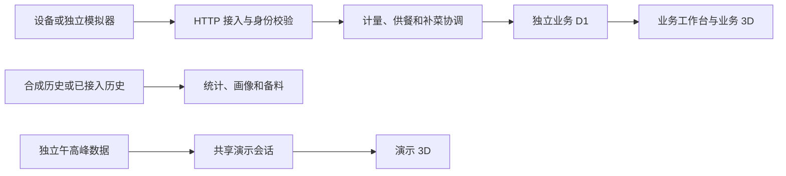

# 知膳 · 天工

餐饮称重数据处理、供餐协作、经营画像与 3D 门店演示系统。以配置好的菜品与碗位关系解释称重数据，支持厨房补菜、历史统计和管理决策；不依赖摄像头识别菜名。

本仓库提供最新完整应用、独立模拟器、共享契约、两套合成数据及验证脚本。源码公开采用[权利保留声明](LICENSE)，不是开放源代码许可。

## 快速运行

需要 **Node.js 24、npm 11、Python 3.9+**，支持 macOS 和 Linux。在仓库根目录运行：

```sh
git clone https://github.com/liiiyiiixiii/xikesong.git
cd xikesong
npm ci
npm run demo
```

首次启动构建应用、校验并解包合成数据、初始化独立 D1，并导入完整历史；根据机器性能可能需要十几分钟。导入期间请等待“演示已就绪”；中断后可重新执行同一命令继续。没有 Cloudflare 账号或模型密钥也能运行基础演示。

| 入口 | 默认地址 | 数据来源 |
| --- | --- | --- |
| 最新 3D 门店 | http://127.0.0.1:4273/ | 96 道主轨菜品、十分钟午高峰合成场景 |
| 管理端与画像 | http://127.0.0.1:5273/admin | 36 菜、42 碗位、33 天合成历史 |
| 厨房看板 | http://127.0.0.1:5273/kitchen | 同一独立历史演示库 |

两套数据分别服务不同演示，不表示同一家门店同一时段的实采结果。`Ctrl+C` 停止服务；再次启动保留 `.demo-state/` 中的本机数据。可通过 `DEMO_PORT`、`THREE_PORT` 修改端口；端口被占用时启动器报错，不结束其他进程。无桌面环境使用 `npm run demo -- --no-open`。

macOS 可双击 `启动项目.command`。模型文字解读需要使用者自行配置服务端密钥；统计、数值画像和 3D 不需要模型调用。

## 开发与空白业务环境

```sh
npm run dev               # 主体、业务工作台、3D 开发服务器
npm run dev:operations    # 同样启动服务，打开业务工作台
```

开发主体在 `5173`，工作台在 `5183/operations`，3D 在 `4173`；3D 的 `/?mode=live` 使用工作台业务接口。业务库位于 `.business-state/`，首次为空，环境明确为 `test`；初始化凭证仅写入该目录的 `connection.json`。它与 `.demo-state/`、旧统计库相互隔离。接入设备前按[业务运行说明](apps/web/docs/software-delivery/OPERATIONS-RUNBOOK.md)配置菜品、设备与规则。

## 工程结构

| 位置 | 职责 |
| --- | --- |
| `apps/web` | 管理与厨房界面、业务工作台、HTTP API、D1 持久化、统计和画像 |
| `apps/restaurant-3d` | Three.js 渲染、演示与业务状态适配，不独立生成业务事实 |
| `tools/sample-provider` | 合成历史、模拟设备及观测数据验证，通过 HTTP 接入主体 |
| `packages/contracts` | 共用类型、Zod 校验和纯展示状态定义；构建为 JS 与类型声明 |
| `datasets` | 版本化完整数据包、SHA-256 清单与生成说明 |
| `tests/integration` | 3D 与主体数据包、投影结果的一致性检查 |
| `scripts`、`docs` | 安装启动、发布检查、架构和开发说明 |

依赖通过一个根锁文件管理；在根目录执行 `npm ci`。共享包使用 `@zhishan/contracts/*` 导入，应用不引用另一个应用的内部运行源码。



供餐状态计算、补菜任务规则、联合事务协调和数据访问分层；查询分页不归属于供餐模块。演示、旧统计和新业务分别保有明确数据边界。详见[当前架构](docs/ARCHITECTURE.md)。

## 常用命令

```sh
npm run data:verify        # 校验两套压缩包及场景一致性
npm run data:extract       # 校验后解包，不覆盖不同内容
npm run test              # 主体、3D、模拟器及跨应用测试
npm run typecheck
npm run lint              # Web Lint 与模块边界检查
npm run build             # 共享包、主体和 3D
npm run demo:smoke        # 对运行中的隔离演示做 HTTP 回归，会重播演示
npm run demo:browser      # 实际浏览器回归，需先安装 Playwright Chromium
npm run simulate:profile # 用完整日观测计算离线画像
npm run check:release     # 发布清单与敏感文件规则
```

`demo:smoke` 仅用于自己的演示实例。跨应用测试会读取完整午高峰数据，耗时可能达到数分钟。详细结果和验证环境见[验证记录](docs/VALIDATION.md)；已完成的安全更新及剩余上游问题见[安全更新记录](docs/SECURITY-UPDATE.md)。

## 接口、数据与文档

- [开发与配置](docs/DEVELOPMENT.md) · [演示与故障排查](docs/DEMO.md) · [数据复现](datasets/README.md)
- [业务 API 与运行恢复](apps/web/docs/software-delivery/OPERATIONS-RUNBOOK.md) · [硬件交接](apps/web/docs/software-delivery/HARDWARE-HANDOFF.md)
- [原称重接入协议](apps/web/docs/INTEGRATION.md) · [智能分析](apps/web/docs/INTELLIGENCE.md) · [3D 业务适配](apps/restaurant-3d/EXTERNAL_DATA.md)
- [变更记录](CHANGELOG.md) · [反馈与修改说明](CONTRIBUTING.md) · [安全信息处理](SECURITY.md)

现有 HTTP 路径和请求响应协议保持兼容。历史文档描述对应日期的实现，以根目录文档与当前源码为准。

## 能力边界与授权

数据集中的顾客、称重和动作均为合成数据。群体取用画像不是个人身份画像；取用重量不等同于销量或喜爱评分。未知、离线与可信零分别处理。真实硬件安装、时钟、断网缓存、现场阈值与生产部署仍需实际验证；软件测试不代表现场验收。

作品展示署名 **天工**，维护者 [liiiyiiixiii](https://github.com/liiiyiiixiii)。原创代码、文档及设计由合法权利人保留权利；第三方组件遵循各自许可证。品牌素材依项目权利人确认的公开分发授权保留，本仓库不另授品牌许可。

[LICENSE](LICENSE) · [署名与素材来源](NOTICE.md) · [第三方声明](THIRD_PARTY_NOTICES.md)
