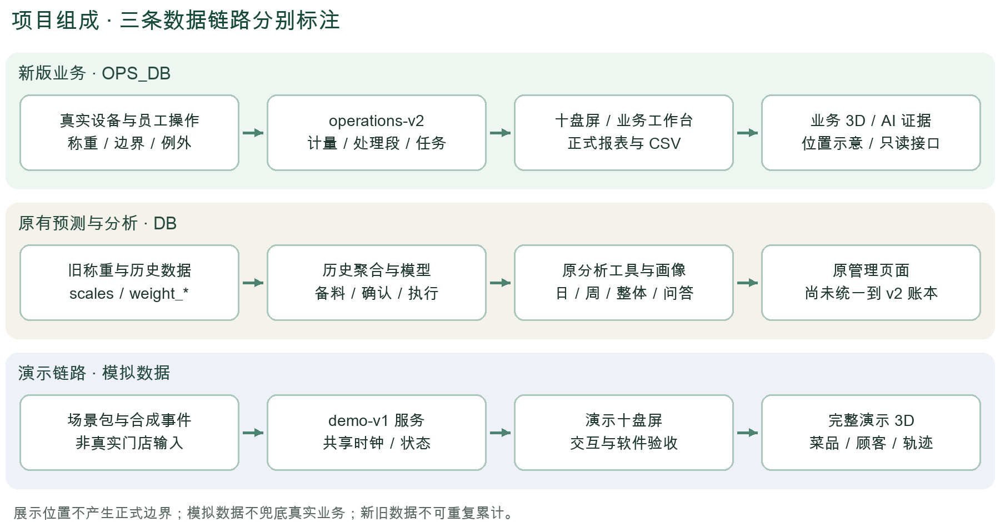
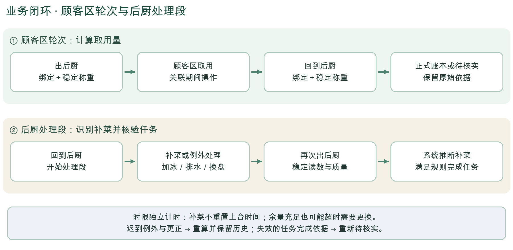

# 红考拉项目功能全景、实现现状与后续建设

版本：1.0 · 核查基准：2026 年 10 月 14 日 · 适用对象：项目负责人及项目团队

交付范围：当前单店完整方案，附待确认扩展路线。

**当前结论：核心业务软件已有较完整的实现和隔离环境验证；真实门店闭环仍需硬件、现场参数、操作约定与试点验收。既有预测、画像和最新业务账本尚未形成统一数据链路。**

本文件对照 2026 年 10 月 5 日需求记录、后续确认方案及当前源码编制。软件功能、测试数据、模拟演示和现场交付分别标注。本文不是生产上线证明，也不把原会谈设想转为新增交付承诺。

本轮仅核查并编制文档，没有修改业务代码、接入设备或部署生产。软件测试数字引用 2026 年 10 月 13 日验收记录；本轮没有重新运行整套业务测试。

维护方式：以本 Markdown 为内容源，PDF 为同版阅读副本。功能发生变化时，同时更新状态、证据、剩余工作和验收条件。

<!-- pagebreak -->

## 阅读导航

1. 项目结论与状态口径
2. 系统组成与业务流程
3. 原始需求及后续确认事项对照
4. 完整模块总览
5. M01-M15 详细功能模块
6. 未完成项与下一步实施计划
7. 页面、接口与数据来源对照
8. 验证情况与完整项目验收标准
9. 待确认参数、术语及证据索引

**建议阅读顺序**：先看第 1、4、6 章了解进展与下一步；按分工阅读第 5 章；联调和交接时使用第 7-9 章。

模块引用采用 M01-M15，后续任务采用 N01-N08，验收场景采用 A01-A12，证据采用 E01-E20。编号用于交叉追踪，不表示项目完成百分比。

<!-- pagebreak -->

## 1. 项目结论与状态口径

### 1.1 现在实现了什么

当前主体已实现独立的 operations-v2 业务服务：设备与菜品绑定、称重及边界事件接入、顾客区轮次核算、正式取用账本、供餐状态、补菜任务、例外登记与更正、时限批次、撤菜记录、取用报表及 CSV、权限与运行保障。

2026 年 10 月 13 日进一步实现后厨十盘屏、固定盘序位置推算、后厨处理段自动补菜识别及任务核验；正常补菜在满足证据条件时不需要员工逐盘点击。最新 3D 已有业务数据模式与统一提示规则。

原有备料预测、执行记录、日／周／整体画像、分析问答与档案页面仍然存在；它们不是全部已经改接新版账本。新版 AI 接口目前提供版本固定的只读证据，不直接调用模型或训练预测。

### 1.2 现在没有实现或没有证明什么

没有发现摄像头自动识菜的交付实现，当前菜品身份来自配置绑定；没有精确夹取次数、个人画像、门口客流转化、多店经营汇总、采购供应链、收入利润核算及排列因果实验闭环。相关方向应分别评估，不默认纳入单店首期。

没有找到当前项目真实硬件联调、门店持续运行和正式现场验收通过的证据。轨道长度、速度、点位映射、采样周期和计量容差需现场提供。业务 3D 的轨道是位置示意，尚不是实测门店模型。

### 1.3 如何理解状态

| 维度 | 标记 | 本文含义 |
| --- | --- | --- |
| 功能 | 已实现 | 存在可追踪的业务实现；不自动表示已上线或实机通过 |
| 功能 | 部分实现 | 已有部分能力，但目标闭环仍有明确缺口 |
| 功能 | 仅演示 | 使用模拟身份、轨迹、事件或受控样例，不代表真实运营 |
| 功能 | 未实现 | 当前核查未找到对应交付实现，不等同业务不需要 |
| 功能 | 待确认范围 | 会谈或规划方向尚未确认为当前交付范围 |
| 验证 | 代码核查 | 本轮读取实现、契约、调用与测试入口 |
| 验证 | 自动化／隔离联调 | 存在对应历史测试记录，注明日期与数据性质 |
| 验证 | 实机／门店验收 | 必须有现场证据；本项目当前统一记为尚未核实 |

因此，不能把“页面存在”“接口存在”“测试通过”“现场可用”合并成一个完成标签，也不以接口数量计算整体完成率。

<!-- pagebreak -->

## 2. 系统组成与业务流程

### 2.1 项目组成

主体工程为 `red-koala`，最新 Three.js 前端为相邻的 `apps/restaurant-3d`。旧 3D 副本及历史 lunch 接口不作为当前交付入口。共享契约为 `operations-v2 / 2.0.0-dev.5`，当前注册 39 个业务端点，另有会话 GET／POST／DELETE。[E02、E03、E18]

**图 1 说明**：新版业务使用独立 OPS_DB；原有备料和分析读取旧业务库及历史数据；演示 3D 读取独立模拟包。新版报表到 AI 的箭头表示只读证据接口，不表示原画像或预测已完成迁移。三条链路不能静默混合、重复累计或相互兜底。

后厨以十盘屏处理即将到达的餐盘；前厅以任务页处理顾客区异常与交接；管理者配置规则、核实账本、看报表；技术人员负责设备凭证、诊断、备份及恢复。完整 3D 用于观察与展示，不应成为后厨的唯一操作入口。

<!-- pagebreak -->

### 2.2 两段业务，两个核算方向

**图 2 说明**：出后厨到回后厨形成顾客区轮次，核算取用；回后厨到再次出后厨形成处理段，核验补菜。两者共享真实称重与事件，但不是同一个统计对象。

1. 设备原始读数及真实边界事件进入后端，经身份、绑定、重复与时序检查后保存。
2. 完整顾客区轮次结合可信操作量计算取用候选；依据不足进入待核实，不强行计零或补齐。
3. 连续读数提供当前余量估计，稳定窗口提供确认值；供餐状态、补菜建议、数据质量分别判断。
4. 符合条件的后厨净增重生成“系统推断”补菜记录；出厨后稳定余量满足既有规则时自动完成对应任务。
5. 加冰、排水、撤菜和换盘保留操作记录。迟到登记及更正触发重算，旧版本保留，失效的自动完成重新待核实。
6. 正式账本供报表、CSV 和只读证据使用；时限从上台批次计起，补菜不会重置。

**权威边界**：轨道推算只用于盘序和展示，不生成正式出入后厨事件；前端动画不参与正式取用计量。原始数据中的毛重、承载净重、食物余量也不能相互替代。

<!-- pagebreak -->

## 3. 原始需求及后续确认事项对照

### 3.1 2026 年 10 月 5 日会谈需求

原文件是会谈整理记录，自身声明不是双方确认规格。下表按需求含义逐项对照，不沿用早期计划中的过期完成状态。[E01、E02]

| 需求 | 模块／当前能力 | 状态与缺口 | 下一步 |
| --- | --- | --- | --- |
| 各菜日、半月、月取用与排名 | M04、M10；轮次账本、日／近15天／近30天／自然月报表、CSV | 软件已实现；“自然半月”与“近15天”不等同；真实计量待验收 | N01、N03 确认统计口径并现场对账 |
| 满、半、少、空四档与提醒 | M05、M08；事实、建议、质量独立 | 已实现；每菜阈值、高峰、半盘规则需经营确认 | N01 配置并验收规则 |
| 出后厨、回后厨两端计量 | M02-M04；边界引用读数、配对和版本化 | 软件已实现；真实边界传感器与时序待联调 | N02、N03 |
| 排除加冰、排水、员工撤菜 | M04、M07、M09；例外、依据、待核实、更正 | 部分闭环；未登记且无法解释的变化不能可靠分类 | N03 确认例外登记流程 |
| 估计夹取次数 | M04 只提供重量与轮次依据 | 精确次数未实现；多动作合并不能靠差值拆开 | 扩展 X02，先验证可行性 |
| 报损与减少浪费 | M09、M11；撤下去向、部分报损和执行记录 | 部分实现；跨日剩余、库存成本和完整报损闭环不足 | N06 明确扩展边界 |
| 固定菜序，不随意加盘 | M01、M03；绑定、固定盘托、校准 | 软件已实现；物理编号和现场纪律待落实 | N01、N02 |
| 菜单／排列／供应链辅助 | M10-M12 提供统计与建议 | 自动决策未实现，也未确认为首期 | 扩展 X04、X05 |
| 门口客流、客群和转化 | 现有 M12 是群体取用结构分析 | 门口客流和顾客关联未实现；不能以演示顾客替代 | 扩展 X01 |
| 低成本、3-5秒刷新、耐油水温度 | M02 有软件接入，M14 有诊断 | 硬件成本、刷新端到端指标与可靠性尚未核实 | N02、N08 实测，不照搬会谈估计 |
| 一周原型／P1、P2 设想 | M15 有演示和测试工具 | 演示已具备；历史日期不是当前交付承诺 | 按依赖和验收门槛推进，不虚构工期 |

<!-- pagebreak -->

### 3.2 后续已确认的使用方式

| 确认项 | 当前实现 | 保留的限制／剩余事项 |
| --- | --- | --- |
| 独立后厨屏，显示所选窗口即将到达10盘 | `/operations/kitchen`；桌面2×5、按距离排序、不足10盘按实际数量 | 配置和定位可信才给顺序；生产位置未接入不使用演示替代 |
| 余量用百分比，未知待核实，估计值带“约” | 十盘卡片已实现，不展示克数 | 管理详情和历史取证仍保留克数；不是全项目删除重量 |
| 普通补菜自动识别，例外才登记 | M07 有系统推断，满足条件自动完成任务 | 默认需明确启用；缺测、拿盘异常、换绑或成分不明需核实 |
| 多盘同时补菜，批量登记加冰／排水 | 自动识别按绑定独立；批量例外逐盘回执、失败重试原请求 | 撤菜／换盘仍需逐盘确认去向、目标菜品与容器 |
| 固定盘托和秤位，取碗后放回原处 | 配置固定偏移，移位上报可锁定重新校准 | 软件不能仅从速度发现机械移位；依赖设备报告或现场检查 |
| 多轨道切换窗口、分别开屏 | 窗口URL、其他窗口待处理数量 | 同轨多窗口的处理归属仍须在真实配置下验收 |
| 正常3D餐盘点击仅显示菜名 | 演示与业务共用提示文字、颜色与优先级 | 图形业务模式为圆环位置示意，尚无真实菜品外形映射 |
| 缺菜黄字、空盘红字、时间独立判断 | 提示自动显示、跟随与避让；超时优先“已超时，请更换” | 密集标签空间不足显示隐藏数量，需放大或看十盘屏 |
| 补菜不重置时间，加冰不当成食物 | 时限批次独立；组成不明不显示确定食物百分比 | 对未知组成的恢复须有可信新依据／绑定，不能靠增重自动恢复 |
| 迟到数据重算并留历史 | 识别版本、任务依据、原始样本、备份与恢复已接入 | 历史记录重算不代表自动把所有旧账补录为补菜 |

上述功能已有代码及 2026-10-13 软件验收记录。所有真实硬件及门店验收状态仍为尚未核实。[E05-E11、E18-E20]

<!-- pagebreak -->

## 4. 完整模块总览

“已实现”仅指表内定义的软件边界。一个模块中同时存在已实现和未实现子功能时，在详细章节逐项区分。

| 编号 | 模块 | 当前功能状态 | 主要剩余工作 |
| --- | --- | --- | --- |
| M01 | 菜品、设备与餐盘绑定 | 绑定已实现；独立菜品主数据部分实现 | 现场映射、统一菜品档案；无视觉识菜 |
| M02 | 称重与设备接入 | 软件已实现 | 固件、通信、采样和故障实测 |
| M03 | 轨道定位与边界 | 软件已实现；实机未核实 | 真实尺寸、速度、边界与移位检测 |
| M04 | 顾客取用计量 | 软件已实现 | 实机对账、异常分类操作约定 |
| M05 | 实时供餐状态 | 软件已实现 | 企业阈值、误报与延迟验收 |
| M06 | 后厨十盘屏 | 软件已实现 | 屏幕布置、真实盘序与多人使用验收 |
| M07 | 自动补菜识别 | 软件已实现（条件式推断） | 稳定称重条件与现场例外流程 |
| M08 | 前厅后厨协同 | 软件已实现；通知渠道部分实现 | 角色责任、页面外通知待决策 |
| M09 | 时限、撤菜与报损 | 部分实现 | 跨日剩余和完整报损／成本闭环 |
| M10 | 统计报表与导出 | 软件已实现 | 真实期间对账与新旧口径说明 |
| M11 | 备料预测与执行 | 旧链路已实现；新版整合未完成 | v2 训练数据适配及真实效果评估 |
| M12 | 智能分析与群体画像 | 旧链路已实现；新版整合未完成 | v2 工具接入、模型联调和分析验证 |
| M13 | 最新3D展示 | 演示已实现；业务展示部分实现 | 实测布局、菜品外形及位置映射 |
| M14 | 系统管理与保障 | 核心软件已实现；生产运维待落实 | 部署、值守、生产备份及服务指标 |
| M15 | 模拟数据与验收 | 软件工具已实现 | 实机数据集、现场试点与正式验收 |

没有为“完整项目”给出虚假的完成率。剩余工作不只是补页面，还包括数据口径整合、设备工程、现场流程和运行验收。

<!-- pagebreak -->

## 5. M01-M15 详细功能模块

### M01 菜品、设备与餐盘绑定

**当前状态：绑定能力已实现；独立菜品主数据部分实现**

**用途**：让每次读数能对应正确菜品、容器和有效历史区间。

**使用角色**：管理者、设备接入人员、负责换菜换盘的员工。

| 细分功能 | 状态 | 已实现内容或明确边界 |
| --- | --- | --- |
| 设备与菜品配置 | 已实现 | 登记设备名称、启用状态、排列顺序、菜品编号／名称、容器引用、皮重和标准满量。 |
| 有效绑定历史 | 已实现 | 按有效期保存配置，限制同一设备绑定区间重叠；历史读数按当时绑定归属。 |
| 撤盘与换盘 | 已实现 | 关闭旧绑定或创建新绑定，确认目标菜品、容器参数及版本；原历史保留。 |
| 同菜多盘 | 已实现 | 任务在单盘／绑定层处理，统计按菜品聚合，避免一盘空就判整菜断供。 |
| 统一菜品主数据／视觉识菜 | 部分／未实现 | 旧库有目录，新业务主要由设备绑定带出菜品；未找到独立完整菜品管理和摄像头识菜实现。 |

**页面入口**：`/operations?view=settings`；碗位详情的撤菜／换盘表单。

**关键接口**：GET /api/v2/devices；PUT /api/v2/devices/{id}；POST /api/v2/operations。

**数据来源**：OPS_DB 的 devices、bindings；旧 weight_catalog 属于另一链路，不能假定自动同步。

**已有验证**：代码核查及既有配置、换绑、并发区间约束测试；实机标签与现场映射未核实。[E03、E04、E09、E19]

**未完成项**：补齐现场设备清册；确认容器是否重复使用、菜品是否多盘；制定统一菜品ID与历史名称策略。独立图片库、配方／SKU及视觉识菜不计入已完成功能。

**完成条件**：每个实物秤位对应唯一当前绑定；换盘后旧读数仍能按旧绑定追溯，新读数不串菜。若建设统一目录，应验证新旧页面使用相同身份而不覆盖历史。

<!-- pagebreak -->

### M02 称重与设备数据接入

**当前状态：软件接收与校验已实现；真实硬件联调尚未核实**

**用途**：可靠接收读数与事件，让重复上传、乱序、设备重启和断线不污染统计。

**使用角色**：硬件／固件人员、后端、部署维护人员。

| 细分功能 | 状态 | 已实现内容或明确边界 |
| --- | --- | --- |
| 原始样本接入 | 已实现 | 接收设备、bootId、sequence、采样时间、毛重和测量状态，保存原始依据及回执。 |
| 设备与边界事件 | 已实现 | 接收进入／离开后厨及故障／恢复等事件，允许引用确切样本。 |
| 幂等与时序保护 | 已实现 | 同号同内容不重复入账，同号异内容冲突；晚到记录可重算，不用旧数据覆盖当前状态。 |
| 质量与故障诊断 | 已实现 | 区分缺测、离线、拿盘和异常；不把丢数据等同零余量。 |
| 硬件工程 | 未核实交付 | 传感器、采集电路、联网、供电、外壳、防油水、热源与漂移需外部实机工作。 |

**页面入口**：`/operations?view=settings` 的设备与诊断；实时页的数据质量。

**关键接口**：POST /api/v2/telemetry/samples；POST /api/v2/telemetry/events；GET /api/v2/devices/diagnostics。

**数据来源**：设备或明确标注的测试客户端；samples、device_events、receipts、sample_tombstones。

**已有验证**：原始报文经 HTTP 与 D1 的历史集成测试，含重复、乱序、重启与缺测；不代表传感器精度合格。[E03、E05、E14、E19]

**未完成项**：落实固件协议、时间同步、缓存与补传、异常编码及总成本；现场验证3-5秒讨论目标能否达到。称重JSONL工具不等于轨道遥测固件。

**完成条件**：设备按约定周期连续上报；对照标准物验证稳定误差、漂移、断线补传与回执；具体误差和时延阈值由试点前共同确定。

<!-- pagebreak -->

### M03 轨道定位与后厨边界

**当前状态：定位与校准软件已实现；位置真实性待现场验证**

**用途**：给十盘屏提供可信到达排序，同时为正式计量保留独立的真实边界证据。

**使用角色**：管理者、硬件网关人员、后厨。

| 细分功能 | 状态 | 已实现内容或明确边界 |
| --- | --- | --- |
| 轨道与窗口配置 | 已实现 | 长度、方向、固定盘托偏移、后厨入口／出口、补菜窗口及心跳有效期可配置。 |
| 服务器位置推算 | 已实现 | 以校准相位、速度、启停和心跳积分；连续停止心跳时位置保持，首尾按轨道长度衔接。 |
| 失效及校准 | 已实现 | 过期停止可信排序；缺序、重启、方向／配置变化或 positionValid=false 后需重新校准。恢复新数据库也需校准。 |
| 校准入口 | 已实现 | 停止轨道、对齐基准，按最新有效心跳的启动号与序号确认相位。 |
| 实际边界与移位发现 | 部分接入 | 真实出入事件接口已就绪；实际传感器待接。没有移位信号时软件不能凭速度识别机械错位。 |

**页面入口**：`/operations?view=settings` 的“后厨轨道与自动补菜”；十盘屏的位置质量提示。

**关键接口**：GET/PUT /api/v2/conveyor/config；POST /api/v2/telemetry/conveyor；POST /api/v2/conveyor/calibrate；GET /api/v2/conveyor/state。

**数据来源**：盘托配置、轨道原始心跳 conveyor_events、持久化运动状态；真实边界来自 device_events。

**已有验证**：代码、启停／速度／过期／移位／备份恢复测试，以及双轨隔离浏览器验证。[E06、E19、E20]

**未完成项**：测量真实轨道、验证编号和运行方向、提供入口出口检测与移位报告；现场确认多窗口归属。不能把会谈中的“约40秒”直接设成整圈周期。

**完成条件**：逐盘对照实物与排序；覆盖首尾、停止恢复、变速、丢包和移位。错误基准下必须停止可信排序；任何显示位置都不直接写取用账本。

<!-- pagebreak -->

### M04 顾客取用计量

**当前状态：轮次核算、账本与修订软件已实现**

**用途**：给取用统计留下可以解释、对账和纠错的原始依据。

**使用角色**：管理者、后端、负责人工核实的人员。

| 细分功能 | 状态 | 已实现内容或明确边界 |
| --- | --- | --- |
| 顾客区轮次 | 已实现 | 同一绑定下，出后厨到返回后厨构成核算轮次；缺边界或冲突保留待核实。 |
| 质量平衡账本 | 已实现 | 根据边界读数和可核验的区内增加／非顾客减少计算取用；使用整数毫克保存核心量。 |
| 异常分类 | 已实现 | 缺测、故障、容器变化、未知操作量及无法解释变化不强行确认。 |
| 追溯与重算 | 已实现 | 记录计算摘要、依据、审核与历史版本；迟到边界和操作更正重算，保持唯一当前账本版本。 |
| 夹取次数与分钟真值 | 未实现 | 轮次重量不能反推出精确夹取次数；不能把一圈取用按比例虚构为逐分钟事实。 |

**页面入口**：`/operations` 碗位详情、轮次依据、操作历史及管理核实。

**关键接口**：GET /api/v2/cycles 与 /cycles/{id}；POST /cycles/{id}/review；GET /bindings/{id}/evidence；GET/POST /operations。以上均在 /api/v2 前缀下。

**数据来源**：绑定、原始样本、真实边界、操作与更正；输出 cycles、ledger、cycle_reviews 和投影作业。

**已有验证**：计量单元、D1／HTTP、跨日、迟到、更正及恢复测试；现场取用误差未核实。[E05、E07、E09、E10、E19]

**未完成项**：确认现场操作如何及时记录，验证边界采样和计量误差。未登记的非顾客变化仍可能影响结果，不能声称只靠称重就完全理解业务。

**完成条件**：标准对照量与逐轮账本一致到约定容差；重复报文不增加取用，重算只更换有效版本；报表、导出与原始依据可逐笔追溯。

<!-- pagebreak -->

### M05 实时供餐状态

**当前状态：状态与建议规则已实现**

**用途**：让员工知道当前供餐情况和应做动作，同时保留不确定性。

**使用角色**：后厨、前厅、管理者。

| 细分功能 | 状态 | 已实现内容或明确边界 |
| --- | --- | --- |
| 四档状态 | 已实现 | 满盘、半盘、少量、空盘；离线、拿盘或不明余量显示未知而非空盘。 |
| 独立补菜建议 | 已实现 | 状态不因暂缓变“满”；建议可关注、暂缓、补菜、紧急或核实。 |
| 按菜规则 | 已实现 | 配置阈值、回滞、持续时间、半盘观察方式及高峰时段。未配置不套企业默认标准。 |
| 当前与确认值 | 已实现 | 连续变化可展示带质量的估计，历史稳定确认值保留自己的时刻。 |
| 同菜供应状态 | 已实现 | 通过有效盘位与可用供餐区间判断供应，不把单盘空误认为整菜断供。 |

**页面入口**：`/operations?view=live`，前厅／后厨任务页，十盘屏与业务3D读取相关投影。

**关键接口**：GET /api/v2/serving/state；GET /api/v2/serving/rules；PUT /api/v2/serving/rules/{dishId}。

**数据来源**：latest、serving_projection、serving_intervals、rules；状态由服务器判断。

**已有验证**：规则、供餐区间和多质量状态测试，旧工作台浏览器回归。[E08、E19、E20]

**未完成项**：每道菜满盘标准、空盘容差、半盘策略及前厅后厨责任仍需门店确认；真实误报率和提醒延迟未核实。

**完成条件**：在真实阈值下由员工复核满／半／少／空；质量变差时降级可见，半盘暂缓仍显示半盘，少量快速变空能及时升级任务。

<!-- pagebreak -->

### M06 后厨十盘屏

**当前状态：独立业务屏与演示屏已实现**

**用途**：让后厨优先看到将到达所选窗口的盘，降低整条3D流水线的信息负担。

**使用角色**：后厨补菜人员、值班负责人。

| 细分功能 | 状态 | 已实现内容或明确边界 |
| --- | --- | --- |
| 十盘到达队列 | 已实现 | 桌面两排五张，按运行方向到入口的距离排序；少于10盘只显示实际数量，告警不改盘序。 |
| 卡片显示 | 已实现 | 菜名、百分比、处理提示；未知为待核实，估计带“约”，卡片不显示克数。 |
| 多窗口与独立开屏 | 已实现 | windowId 保存在URL，切换窗口，显示其他窗口待处理数。 |
| 后厨处理中列表 | 已实现 | 已进后厨的盘退出到达队列，异常事项单独列出；定位失效时不延续可信排序。 |
| 例外与明细 | 已实现 | 多选加冰／排水逐盘回执；单盘可查看推断历史、登记撤菜／换盘及补充依据。 |

**页面入口**：业务 `/operations/kitchen`；演示 `/operations/kitchen?mode=demo`；可带 windowId。首页、工作台和3D有入口。

**关键接口**：GET /api/v2/kitchen/board；GET /api/v2/kitchen/visits；POST /api/v2/operations。演示屏读取 /api/demo/v1/manifest 与 /state。

**数据来源**：业务来自供餐、时限、配置与服务器位置聚合；演示来自演示场景和模拟状态，不能互换。

**已有验证**：独立test库实际HTTP／D1浏览器：2×5、双窗口、八盘、未知、逐盘回执、移动端、位置过期均有通过记录。[E06、E11、E20]

**未完成项**：选择现场屏幕位置、尺寸及窗口命名；验证多员工协作与异常登记负担；同轨多个窗口的真实业务归属需核对。

**完成条件**：员工不打开完整3D即可判断下一批盘；顺序与实际到达一致，异常状态可读，断开位置数据后不显示虚假最近十盘。

<!-- pagebreak -->

### M07 自动补菜识别

**当前状态：条件式系统推断及自动任务核验已实现**

**用途**：让正常补菜不必逐盘登记，把员工操作集中到例外和证据不足的情况。

**使用角色**：后厨、管理者、计量维护人员。

| 细分功能 | 状态 | 已实现内容或明确边界 |
| --- | --- | --- |
| 后厨处理段 | 已实现 | 同一绑定从进入后厨到再次离开，关联前后稳定读数、连续数据与期间操作。 |
| 自动识别 | 已实现 | 食物组成明确、绑定一致、无冲突例外、称重完整，净增重超过容差才识别；来源标为系统推断。 |
| 任务自动核验 | 已实现 | 对应补菜被核验，出厨后稳定余量满足既有规则，可无接手／操作编号自动完成；补后仍不足继续提醒。 |
| 异常与历史 | 已实现 | 无增重不算补菜；顾客区增重不冒充后厨补菜；迟到例外及重传重算，保留版本并使失效完成重新待核实。 |
| 启用与保守处理 | 已实现 | 配置显式启用，从启用后生效，不批量改旧账；关闭后已有记录仍可更正。拿盘导致缺测或异常的处理段需核实。 |

**页面入口**：十盘屏的自动识别记录；任务详情的系统历史；设置页启用开关。

**关键接口**：GET/PUT /api/v2/conveyor/config；GET /api/v2/kitchen/visits；称重、边界、操作接口驱动后台重算。

**数据来源**：真实称重、边界、绑定和例外记录；kitchen_visits 保存当前及修订，任务保存完成所依据的处理段与版本。

**已有验证**：普通补菜、两盘并发无人工操作、补后不足、无补菜、缺测、故障、重复报文、迟到加冰及关闭开关后失效测试。[E05、E07-E09、E19]

**未完成项**：这不是自动识别一切物质。加冰后组成不明不以含冰重量算百分比；现场需确定何种操作必须登记，以及拿碗操作怎样保留可信依据。

**完成条件**：真实常规补菜无需点击即可闭环；例外和缺证据不误认；重复上报不增造记录，失效任务可追溯并重新核实；补菜不改变上台时限。

<!-- pagebreak -->

### M08 前厅后厨任务协同

**当前状态：任务闭环已实现；通知渠道部分实现**

**用途**：把状态提醒变成可交接、可核验、多人操作不冲突的待办。

**使用角色**：后厨、前厅、值班管理者。

| 细分功能 | 状态 | 已实现内容或明确边界 |
| --- | --- | --- |
| 任务生命周期 | 已实现 | 待处理、已接手、待核验、暂缓、已完成与已取消，动作由后端权限和当前状态决定。 |
| 多人协作 | 已实现 | 接手、责任交接、暂缓期限、版本冲突及幂等回执；同绑定限制一条活动任务。 |
| 完成依据 | 已实现 | 自动核验、旧人工报告完成及规则允许的人工核实；报告完成不等于已核验完成。 |
| 升级与持久化 | 已实现 | 空盘紧急升级、暂缓到期重新评估；任务和处理历史持久保存。 |
| 提醒渠道 | 部分实现 | 页面状态和用户开启的浏览器提示音；页面关闭后的推送／短信／企业消息通知未实现。 |

**页面入口**：`/operations?view=kitchen`、`/operations?view=front`；实时总览及任务详情。

**关键接口**：GET /api/v2/refill/tasks 与 /tasks/{id}；POST /api/v2/refill/tasks/{id}/actions；GET /api/v2/serving/state。

**数据来源**：tasks、task_actions、供餐投影、操作及核验依据；页面关闭不停止服务端任务调度。

**已有验证**：并发抢单、交接、暂缓、完成、人工核验、持久恢复及角色权限浏览器测试。[E08、E09、E14、E19、E20]

**未完成项**：门店确认责任区、交接和升级时限；决定是否另建离屏通知。工作站凭证不是完整的人事账号和排班系统。

**完成条件**：同盘不重复派发活动任务；两人操作有明确冲突反馈，关闭重开后任务仍在；使用已选通知渠道完成真实前厅后厨交接。

<!-- pagebreak -->

### M09 时限、撤菜与报损

**当前状态：时限与撤下记录已实现；完整报损闭环部分实现**

**用途**：把放置时间与余量分别管理，记录撤下原因及去向，为浪费分析提供依据。

**使用角色**：后厨、前厅、管理者。

| 细分功能 | 状态 | 已实现内容或明确边界 |
| --- | --- | --- |
| 时限规则与批次 | 已实现 | 按菜规则创建具体绑定的上台批次，保留规则快照及开始时间。 |
| 预警与超时 | 已实现 | 临近时限和已超时独立于余量；补菜不重置，更换提示优先。 |
| 部分／整盘撤下 | 已实现 | 记录原因、保留／报损去向、重量质量；部分保留原批次，整盘撤下或换盘统一关闭。 |
| 未知量与历史 | 已实现 | 允许未知重量，不伪造精确损耗；操作更正和历史保留，可按范围查看撤下记录。 |
| 完整损耗管理 | 部分实现 | 原有执行页有过期／闭店／其他报损及后厨保留量；跨日剩余再上台、库存账和成本核算未形成统一闭环。 |

**页面入口**：`/operations?view=freshness`；原有 `/admin?view=daily` 的备料执行与报损；旧时限相关页面。

**关键接口**：/api/v2/freshness/rules、/batches、/removals；POST /api/v2/operations；旧 /api/freshness 与 /api/preferences。

**数据来源**：新 freshness_rules、freshness_batches、freshness_actions 及操作；旧 freshness 与 weight 执行记录单独存储。

**已有验证**：规则／批次、部分保留、整盘撤下、换盘关闭、未知重量及浏览器回归。[E09、E12、E15、E19、E20]

**未完成项**：澄清何种“保留”可跨日、谁审核、如何重新上台及追溯；完整报损、成本和跨日库存属于需确认的扩展，不把简单去向记录当成已解决。

**完成条件**：同盘含量充足也能按时限要求更换；部分撤下不重置批次，整盘只关闭一次。扩展获批后，跨日批次身份、数量与去向可连贯对账。

<!-- pagebreak -->

### M10 统计报表与导出

**当前状态：新版取用报表已实现；新旧口径明确分离**

**用途**：让管理者按可追溯的正式取用量比较菜品，并看到供应与数据质量限制。

**使用角色**：门店负责人、运营、财务／数据分析人员。

| 细分功能 | 状态 | 已实现内容或明确边界 |
| --- | --- | --- |
| 日期范围 | 已实现 | 单日、近15天、近30天、完整自然月和最多31天自定义；按北京时间轮次结束归属。 |
| 排名与约束 | 已实现 | 菜品取用合计、排名、覆盖及缺菜分钟；同菜多盘缺菜采用共同空盘区间。 |
| 同版本CSV | 已实现 | 查询与导出使用一致版本；数据变动或重算中要求重新读取，不混合半更新结果。 |
| 原始依据追查 | 已实现 | 可回查轮次、相关操作与修订，不把未知量填成可信零。 |
| 其他经营指标 | 未实现／非本口径 | 不提供取用对应的收入、利润、独立人数或精确夹取量；旧差分接口选项不能据此认定已适配旧数据查询。 |

**页面入口**：`/operations?view=reports`；历史旧统计从 `/admin?view=daily` 查看。

**关键接口**：GET /api/v2/reports/consumption；GET /api/v2/reports/consumption/export；GET /api/v2/intelligence/evidence。

**数据来源**：新账本 ledger 的当前有效版本、绑定、供餐区间；旧 legacy_delta_v1 不与 cycle_balance_v2 相加。

**已有验证**：跨日、同菜多盘、供应覆盖、版本冲突、重算及CSV对账测试与浏览器验证。[E07、E10、E19、E20]

**未完成项**：现场确认“半月”是否近15天或自然半月、跨午夜营业日及导出使用流程。旧数据转换与新版历史训练不是当前报表自动提供的能力。

**完成条件**：抽取真实完整日及跨日轮次，对照账本、报表与CSV一致；未知及供应约束清楚显示；修改原操作后旧导出版本不能冒充最新。

<!-- pagebreak -->

### M11 备料预测与执行

**当前状态：旧数据链路功能已实现；新版账本整合未完成**

**用途**：基于已有日级历史提出次日备料建议，再由人员确认、执行和反馈。

**使用角色**：备料负责人、门店管理者、数据分析人员。

| 细分功能 | 状态 | 已实现内容或明确边界 |
| --- | --- | --- |
| 历史与截止时点 | 已实现（旧链路） | 历史导入、日记录、20:00快照和预测作业；区分模拟回放、缺失和可用样本。 |
| 次日预测 | 已实现（旧链路） | 已有重量模型、建议量与样本限制；有回测／评估实现，不等于现场预测效果已证明。 |
| 人工确认 | 已实现（旧链路） | 逐菜确认备料计划；修改建议或试供量需说明，不让重算覆盖已确认计划。 |
| 执行记录 | 已实现（旧链路） | 记录备料、追加、后厨保留及分类报损，查看计划差异和有限预测误差。 |
| 新版计量训练数据 | 未完成 | 当前读取 weight_* 与旧 scales 数据；未发现把 v2 正式账本完整接到日样本、训练、预测及评估的通路。 |

**页面入口**：`/admin?view=daily`；从业务工作台“原有备料与报损”进入。

**关键接口**：GET/POST /api/preferences（generate／confirm／execution）；/api/preferences/import、/export、/history、/jobs。

**数据来源**：旧 DB 中 weight_catalog、weight_daily、weight_snapshots、weight_models、weight_forecasts、weight_plans、weight_executions、weight_evaluations。

**已有验证**：预测模型、历史导入、截止时点、执行校验及旧页面测试；真实门店泛化效果未核实。[E15、E19、E20]

**未完成项**：需 N04 建立带版本和供应质量的 v2 日样本适配，不直接把账本合计复制成训练真值；再评估样本不足、缺菜、换菜和时限报损对预测的影响。

**完成条件**：同一截止时点能追溯输入账本版本；不使用未来或低可信数据训练；预测、确认、执行链路在真实样本上验收，明确误差与适用限制。

<!-- pagebreak -->

### M12 智能分析与群体画像

**当前状态：既有分析已实现；新版证据整合部分实现**

**用途**：帮助管理者理解整体、菜品、日期和时段的取用结构，并提出有依据的经营建议。

**使用角色**：门店管理者、运营、数据分析人员。

| 细分功能 | 状态 | 已实现内容或明确边界 |
| --- | --- | --- |
| 结构化画像 | 已实现（旧链路） | 日、周、整体、菜品与趋势页面，结合样本、供应及数据完整性表达结论。 |
| 只读分析问答 | 已实现（旧链路） | 工具先取证、模型后解释；提供只读工具，不自动改供应、数据库或菜单。 |
| 模型连接与档案 | 已实现软件能力 | 有模型密钥连接测试、配置、分析档案和过期标识；本轮未测试真实外部模型连接状态。 |
| v2证据接口 | 已实现 | 返回指定版本和截止时点的报表，标记 externalModelCalled=false、training.enabled=false。 |
| 完整新版AI与个人画像 | 未完成／未实现 | 新版证据尚未完成与旧Agent、画像、预测统一衔接；未实现个人识别、客流关联和利润因果分析。 |

**页面入口**：`/admin?view=intelligence`；新版报表页可读取只读AI证据。

**关键接口**：/api/intelligence 及 /config、/portrait、/daily-visual、/archives、/range-report、/trend-summary、/visual-trend；/api/v2/intelligence/evidence。

**数据来源**：旧 analysis/tools 读取 preferences/scales/freshness 和档案；新版只读证据读取 v2 账本报表，两套来源需显式区分。

**已有验证**：分析工具、范围、画像与档案版本测试；本轮源码核实证据接口不调用模型。[E10、E16、E19、E20]

**未完成项**：优先 N05 接入新版只读证据、统一来源和版本；真实模型、故障提示、提示词和引用需再联调。重量排名不能直接叫喜爱程度，人均需真实客流。

**完成条件**：每项数值能回查指定账本／数据版本；无证据时明确不能回答；模型失败不伪装成功，建议仅人工确认，不输出未经证明的个人或因果结论。

<!-- pagebreak -->

### M13 最新3D展示

**当前状态：演示已实现；业务展示已实现部分能力**

**用途**：用可视场景展示整体运行及异常提示，作为十盘屏之外的观察入口。

**使用角色**：项目演示人员、管理者、巡视人员。

| 细分功能 | 状态 | 已实现内容或明确边界 |
| --- | --- | --- |
| 完整模拟门店 | 仅演示 | 默认 demo-v1 场景含菜品、盘、顾客与员工动作，共享回放；96道菜、174盘、80席是模拟规模。 |
| 业务模式 | 已实现 | ?mode=live 经会话读取当前真实业务绑定、余量、时限与轨道状态；无登录不读业务数据。 |
| 提示规则 | 已实现 | 正常盘点击仅名字；少量黄、空盘红；临期黄、超时红且优先；跟随、避让、不抢焦点。 |
| 位置显示 | 部分实现 | 校准轨道按服务端位置显示圆环示意，未接入／失效明确标记固定排列；不借演示身份或坐标。 |
| 真实门店孪生 | 未完成 | 实测轨道形状、场景坐标、真实菜品外形以及顾客／员工轨迹未接入。 |

**页面入口**：最新3D工程根入口 `/` 为演示；`/?mode=live` 为业务；`/menu.html` 和 `/plate-detail.html` 为静态模型展示。

**关键接口**：演示 /api/demo/v1/*；业务 /api/v2/session、/kitchen/board、/conveyor/state。

**数据来源**：模拟场景清单和演示包，或明确环境下的 v2 业务响应；不能将演示人物当真实客流。

**已有验证**：3D历史60项测试；隔离业务浏览器和受控演示浏览器验证标签、优先级、跟随与避让。[E17-E20]

**未完成项**：如需要真实完整店面，执行 N07 采集几何和映射；决定业务是否需要真实菜品外形。现场未测参数不写成默认配置，3D没有权威记账职责。

**完成条件**：业务身份、百分比、时限和位置与主体一致；无位置仍明确未接入；真实场景升级后按现场控制点验收，不改变原始边界和账本口径。

<!-- pagebreak -->

### M14 系统管理与运行保障

**当前状态：核心后台保障已实现；生产运行待落实**

**用途**：让业务可授权访问、可持续调度、可诊断和恢复，同时保护原始依据。

**使用角色**：管理员、后端与部署维护人员。

| 细分功能 | 状态 | 已实现内容或明确边界 |
| --- | --- | --- |
| 会话与授权 | 已实现 | 设备／员工／管理角色、凭证发放撤销、设备和轨道授权范围；浏览器使用环境专属HttpOnly会话。 |
| 环境隔离 | 已实现 | test、demo、live 明确配置；OPS_DB 独立业务链路，缺绑定报不可用，不回退演示库。 |
| 后台作业 | 已实现 | 持久任务、租约、失败重试、定时处理和运行心跳，不依赖网页常开。 |
| 备份与保留 | 已实现软件机制 | 逻辑备份、同环境新空库恢复、摘要与锁保护；原始证据保留，样本清理后保留身份记录。 |
| 完整生产运维 | 部分实现 | 本地维护与部署模板已有；生产域名、值守、监控渠道、容量与恢复指标未验收。 |

**页面入口**：`/operations?view=settings` 的规则、凭证、运行诊断与保留策略；备份恢复使用维护脚本。

**关键接口**：/api/v2/access/credentials 及 /{id}/revoke；/system/diagnostics；GET/PUT /system/retention；/session。

**数据来源**：credentials、receipts、jobs、system、maintenance；独立数据库身份与环境；无明文令牌写入前端。

**已有验证**：角色、原子回执、跨环境、作业租约、重启、备份恢复、清理及Worker本地打包测试。[E03、E14、E19、E20]

**未完成项**：需安排真实部署、秘密配置、远程备份、值守与告警；确定服务容量及恢复目标。没有完整组织／人员账号、单点登录或多租户门店管理。

**完成条件**：生产前完成权限与隔离核验、备份恢复演练、浏览器关闭后的作业连续性及故障处置；恢复后重新校准位置，不复制“已运行”的假心跳。

<!-- pagebreak -->

### M15 模拟数据与验收工具

**当前状态：软件演示与验证工具已实现；现场验收未核实**

**用途**：在没有真实设备的阶段验证算法、接口与页面，同时保留模拟和事实之间的边界。

**使用角色**：前后端、硬件联调、项目验收负责人。

| 细分功能 | 状态 | 已实现内容或明确边界 |
| --- | --- | --- |
| 统一演示包 | 已实现（模拟） | 固定场景与身份、事件回放、共享时钟、暂停／重播；服务端状态与前端动画对齐。 |
| 独立原始输入 | 已实现 | sample-provider及JSONL上传工具可供受控数据；模拟真值留在验证端，不作为系统业务事实。 |
| 单元与D1／HTTP验证 | 已实现 | 覆盖计算、契约、事务、幂等、任务、报表和恢复；严格区分直接fixture和真实HTTP。 |
| 浏览器与构建 | 已实现 | 独立测试库操作、受控3D显示场景、移动端、类型检查、Lint和本地构建。 |
| 实机与经营结果验证 | 未核实 | 没有以传感器精度、长期在线、员工效率或节约金额通过现场验收的证据。 |

**页面入口**：演示3D、`/operations/kitchen?mode=demo`；独立测试服务与测试脚本。

**关键接口**：/api/demo/v1/manifest、/state、/events、/reports、/control；测试客户端使用正式 v2 接口。

**数据来源**：演示场景和数据包、独立test库原始报文、受控浏览器响应；与生产事实分开保存。

**已有验证**：2026-10-13 记录主体282项、3D60项通过及补充测试；本轮仅核查记录和入口，不重跑全量业务测试。[E17、E19、E20]

**未完成项**：补充真实故障及操作数据集，约定允许误差、有效覆盖、提醒时延、稳定运行时长和试点负责人；模拟通过不抵扣现场验收。

**完成条件**：按A01-A12逐项签收并保存原始输入、对照结果和环境；实机验收表明确哪些已通过、未通过或仍未执行。

<!-- pagebreak -->

## 6. 未完成项与下一步实施计划

### 6.1 三类工作必须分开安排

| 类别 | 具体未完成事项 | 当前处理原则 |
| --- | --- | --- |
| 核心落地必需 | 设备固件、真实采样与边界、轨道参数、盘托映射、现场校准、例外操作规范、试点验收 | 优先 N01-N03，再执行 N08；不重复建设已经存在的十盘屏与自动补菜接口 |
| 已有模块补齐 | 新账本接入备料与画像、统一菜品主数据、完整撤菜去向、真实3D映射、运行保障部署 | N04-N07；按单店验收范围分批交付，避免把演示迁移当成实机验收 |
| 待确认扩展 | 客流、精确夹取、多店、采购成本、排列效果、跨日库存 | X01-X06；先确认目标和数据条件，再独立估算与立项 |

**建议依赖顺序**：N01 → N02 → N03 → N08 核心试点。N04 在 N03 产生可信账本后推进；N05 依赖 N03 的只读证据，涉及预测时再依赖 N04；N06 先确认范围，基础撤菜核实随 N03 完成；N07 在 N02 提供真实配置后推进。N04-N07 不应阻塞仅以计量、提醒和后厨操作为目标的首轮试点。

以下角色是建议的责任分工，并非已指定人员或承诺排期。没有实测依据前，不承诺设备精度、持续运行时长、经营收益或上线日期。

<!-- pagebreak -->

### 6.2 后续任务卡

#### N01 业务口径与现场参数冻结

**目标**：把软件可配置项变成门店认可的操作和计量口径。

**工作内容**：建立菜品ID、设备ID、盘托与容器映射；逐菜确认皮重、满盘标准、四档阈值、半盘补菜政策和时限；确认营业日、近15天与自然半月的含义；定义加冰、排水、取碗、换盘、撤菜、断网的操作约定。

**负责角色**：业务负责人主责；后厨主管、硬件和后端共同复核。

**前置条件**：现场点位及设备候选方案可提供；原始会谈中的设想经业务确认。

**交付物**：参数台账、业务规则表、操作流程和范围清单。

**验收标准**：关键字段有负责人、单位和来源；演示数值不成为生产默认；未决项有明确处置，不以假数据填满。

#### N02 真实设备与轨道接入

**目标**：让服务接收到可追溯的真实读数、真实边界和可信运行遥测。

**工作内容**：落实设备协议、身份凭证、时钟与序号；校准称重；采集启停、速度、方向与心跳；配置轨道和窗口、固定盘托偏移；验证断线、重启、移位后的不可信状态及恢复。

**负责角色**：硬件负责人主责；后端负责协议校验与诊断，现场人员负责基准确认。

**前置条件**：N01设备与位置台账；可控现场或台架；独立联调环境及凭证。

**交付物**：真实原始报文样本、固件接口说明、称重校准记录、轨道配置与恢复记录。

**验收标准**：实测盘序和页面一致；停机不漂移；过期、移位、重启缺基准不显示可信顺序；边界来自真实事件；误差和时延按双方实测后确认的标准签收。

<!-- pagebreak -->

### 6.2 后续任务卡（续）

#### N03 单店计量与补菜闭环验收

**目标**：证明普通补菜无需点击，同时异常不会污染正式取用。

**工作内容**：按A01-A10回放并现场执行；核对出入厨称重与人工对照；多盘补菜、补后不足、无补菜通过、加冰排水、拿盘换绑及缺测逐项验收；核对迟到更正、任务重开、超时不重置。

**负责角色**：后端与前端共同负责软件；后厨主管确认操作负担；硬件人员提供原始依据。

**前置条件**：N01操作约定与N02真实数据；用于对照的独立称重及记录方式。

**交付物**：逐场景验收表、输入回执、轮次／处理段／任务的版本链、待修复问题清单。

**验收标准**：普通补菜无逐盘确认；例外保留逐盘回执；不可解释增减进入待核实；重复报文不重复记账；人工对照误差符合现场约定，且能追溯每个结论。

#### N04 统一统计与备料数据链路

**目标**：使备料建议建立在新版可审计数据上。

**工作内容**：设计v2账本到每日菜品聚合的适配层；明确修订、缺测、供给不足、补菜与撤菜的统计口径；映射旧菜品ID；隔离旧数据和演示数据；更新训练输入、回测与前端来源提示，保留人工确认和执行记录。

**负责角色**：后端／数据负责人主责；前端和业务负责人参与。

**前置条件**：N03可信样本；稳定菜品主数据；预测目标、历史窗口和质量门槛确认。

**交付物**：版本化聚合契约、迁移／隔离方案、预测对照报告、页面来源标识。

**验收标准**：报表、聚合与预测输入可逐日对账；更正可追踪；同一事件不被新旧链路重复计算；缺乏有效历史时明确无建议，不伪造预测准确率。

<!-- pagebreak -->

### 6.2 后续任务卡（续）

#### N05 智能分析与画像证据统一

**目标**：让分析页面引用明确、可复核的业务依据。

**工作内容**：将旧分析工具按范围接入v2只读证据；标注证据版本、时间和数据质量；区分群体取用结构与人群属性；如启用模型，核实配置、调用失败处理和引用覆盖；保留只读权限与无证据拒答。

**负责角色**：分析／后端负责人主责；业务负责人审查指标含义，前端更新来源提示。

**前置条件**：N03稳定账本；若使用预测，需N04；模型接入条件和使用范围确认。

**交付物**：工具映射清单、带版本的分析样例、模型连通测试记录和不支持问题清单。

**验收标准**：同一问题的数字能回到正式报表；模型不能写业务；不从重量推导人数、收入或个人身份；模型不可用时不把模板结论伪装成实时AI结果。

#### N06 撤菜、保留与报损边界补齐

**目标**：先让已存在的撤菜记录可核对，再判断是否建设完整库存闭环。

**工作内容**：首轮核实部分／整盘撤下、原因、去向和操作修订与取用账本的隔离；单独评估跨日保留、再上台、库存损耗和成本结转，确认后才扩展数据模型及页面。

**负责角色**：业务／后厨负责人主责；后端与产品共同定义边界。

**前置条件**：基础工作依赖N01、N03；完整跨日能力需X06确认，成本需X04确认。

**交付物**：基础撤菜对账表；可选的跨日流转与报损规格。

**验收标准**：撤下量不算顾客取用；去向与依据可查；未启用跨日能力前不声称完整剩余库存可追踪。

<!-- pagebreak -->

### 6.2 后续任务卡（续）

#### N07 业务3D真实场景映射

**目标**：在确有需要时把圆环位置示意接入门店布局。

**工作内容**：提供门店轨道测绘、坐标和点位映射；将真实盘托、绑定与可视对象对应；补充菜品外观映射；在实际屏幕上验证标签密集、延迟、窗口导航和未知位置；不引入模拟顾客充当业务事实。

**负责角色**：3D前端主责；现场和硬件提供测绘基准。

**前置条件**：N02真实位置可信；门店图纸、尺寸与展示精度要求确认。

**交付物**：门店场景映射配置、真实ID对照、实屏演示与回归记录。

**验收标准**：实测盘位与画面可对应；未接入明确提示；缺菜与超时优先级正确；位置示意不产生账本边界；十盘屏可独立使用。

#### N08 试点与生产运行准备

**目标**：完成可签收的单店试点与运维交接。

**工作内容**：在隔离试点环境执行A01-A12；明确权限、秘密、远程备份、数据保留与后台作业；验证恢复后校准、网络故障与值守流程；收集人员使用问题后修复。生产发布另行安排。

**负责角色**：项目负责人组织签收；业务、硬件、前后端与运维各自确认责任。

**前置条件**：核心依赖N01-N03；选入验收范围的N04-N07分别完成；现场参数及验收阈值已确认。

**交付物**：签字验收表、问题闭环、运维手册、备份恢复记录、发布检查结果。

**验收标准**：所有必需场景有证据和结论；阻断问题关闭；未通过与未执行项明确；不存在演示冒充真实、未知计零或恢复后未经校准继续可信排序。

<!-- pagebreak -->

### 6.3 待确认扩展路线

| 编号／方向 | 尚缺能力与先决条件 | 建议的范围确认与完成判据 |
| --- | --- | --- |
| X01 客流及转化 | 真实入口计数、进店定义、时段对齐；现有画像不是客流系统 | 先确认采集方式、去重与隐私边界；对照人工计数验收后才谈转化，不能由取用重量换算人数 |
| X02 精确夹取次数 | 单次夹取的可辨识信号、独立标注与检测方法 | 先做可行性实验；区分事件检测率与重量准确度；不能承诺每次减重就是一次夹取 |
| X03 多店汇总 | 门店身份、数据隔离、统一菜品映射、权限及跨店聚合 | 独立立项；明确组织模型和可比口径；企业门店数量不构成现有多店功能的证明 |
| X04 采购与成本 | 采购、原料、配方、库存、供应商、成本／收入系统 | 先确定外部系统与主数据；完成业务对账再做利润或采购建议；取用重量本身不等于收入 |
| X05 菜序实验与经营效果 | 排列版本、实验分组、客流与时段等混杂因素 | 先定义假设和衡量方法；仅相关性不能证明排列改善销量；任何调整保留人工决定 |
| X06 完整跨日剩余管理 | 保留库存、存放条件、再次上台、损耗与去向连续追踪 | 先确认业务及食品管理要求；批次跨日可追踪后再宣称闭环，现有批次时间和撤菜记录不等同库存系统 |

这些方向当前记为“待确认范围”，其中部分会谈设想没有明确承诺。是否纳入完整后续版本，应由项目负责人按价值、数据条件及单店试点反馈决定。

<!-- pagebreak -->

## 7. 页面、接口与数据来源对照

### 7.1 新版业务页面

下表路径相对主体服务。除标有演示的入口外，新版页面需要业务会话和对应角色权限。API 均以 `/api/v2` 为前缀；这里列的是主要调用，不替代完整契约。[E03、E11-E14]

| 页面入口／角色 | 主要功能 | 关键接口（省略前缀） | 权威数据来源 |
| --- | --- | --- | --- |
| `/`；所有角色 | 首页进入工作台、后厨屏、既有页面 | 具体业务在目标页获取 | 导航本身不构成业务数据 |
| `/operations/kitchen`；后厨 | 所选窗口前10盘、处理事项、百分比、快捷例外 | GET /kitchen/board、/conveyor/state；POST /operations；GET /session | OPS_DB：固定盘托配置、遥测位置、供餐、任务与时限投影 |
| `/operations?view=kitchenScreen`；后厨 | 工作台内十盘入口 | 同上 | 同独立十盘屏 |
| `/operations?view=live`；管理／前后厨 | 实时餐盘、轮次与依据 | GET /serving/state、/cycles、/bindings/{id}/evidence | 原始读数、绑定与顾客区轮次投影 |
| `/operations?view=kitchen`；后厨 | 详细任务、历史操作及处理 | GET /refill/tasks、/operations；POST /refill/tasks/{id}/actions、/operations | 补菜任务、操作和处理段版本 |
| `/operations?view=front`；前厅 | 顾客区任务、交接、人工核实 | GET /refill/tasks；POST /refill/tasks/{id}/actions、/cycles/{id}/review | 同一任务链和轮次核实结果 |
| `/operations?view=reports`；管理 | 正式日／区间取用与CSV | GET /reports/consumption、/reports/consumption/export | v2正式轮次账本；估计／异常分列 |
| `/operations?view=freshness`；前后厨／管理 | 上台批次、时限、撤菜记录 | GET /freshness/batches、/freshness/removals；POST /freshness/batches、/operations | 批次及撤菜操作；独立于补菜时钟 |
| `/operations?view=settings`；管理／技术 | 设备绑定、供餐／时限／轨道规则、诊断和凭证 | /devices、/serving/rules、/freshness/rules、/conveyor/config、/conveyor/calibrate、/access/credentials、/system/* | 版本化配置、设备状态、凭证权限、运行诊断 |

“关键接口”表示页面能力涉及的接口组，不表示每次打开页面都会调用该组所有写接口。具体权限、请求字段和枚举以 E03 契约为准。

<!-- pagebreak -->

### 7.2 原有页面、分析与3D入口

| 页面／入口 | 主要接口 | 数据来源与当前限制 |
| --- | --- | --- |
| `/kitchen` 旧后厨页 | /api/scales/state、/api/scales/actions；按所选功能获取其他旧接口 | 旧scales链路，不能等同独立十盘屏或v2账本；新交付优先从/operations进入 |
| `/admin` 管理页内备料、历史 | /api/preferences、/history、/jobs、/import、/export（后四项接在/api/preferences下） | DB内weight_*计划／历史与旧scales；生成、确认和执行已存在，尚未改接v2正式账本 |
| `/admin` 日／周／整体画像、趋势与区间 | /api/intelligence/portrait、/daily-visual、/visual-trend、/trend-summary、/range-report | 旧历史、聚合及分析工具；页面有来源与证据约束，但不代表新账本统一迁移完成 |
| `/admin` 分析问答、配置、档案 | /api/intelligence、/config、/archives、/archive-jobs（后三项接在/api/intelligence下） | 只读工具、存档和模型配置；实际模型连通及生产凭证未在本轮核实 |
| 原有新鲜度视图 | /api/freshness | 原有批次／历史链路；新版以/api/v2/freshness/*为准，不能直接相加 |
| 最新3D `/` | /api/demo/v1/manifest、/state、/events等 | 统一演示包；顾客、菜品流转、动作和场景均为模拟 |
| 最新3D `/?mode=live` | /api/v2/session、/kitchen/board、/conveyor/state（后两项同v2前缀） | 真实业务身份与服务器位置，圆环示意；未配置保持未接入，不读演示位置兜底 |
| `/operations/kitchen?mode=demo` | /api/demo/v1/manifest、/state等 | 模拟十盘屏，用于展示和软件验收；不是真实门店事实 |
| 最新3D menu.html、plate-detail.html | 本地菜单／容器数据与资源 | 静态展示页，不是生产菜品主数据维护或实机盘位管理 |

最新 3D 是单独的 Vite 前端工程，其 `/` 与主体首页不是同一个部署入口；实际访问地址、代理和会话配置应在联调环境说明中明确。不要以两个工程都存在同名URL推断它们属于同一页面。[E13、E15-E18]

<!-- pagebreak -->

### 7.3 接口组与正式依据

| 接口组（前缀 /api/v2） | 读写／作用 | 正式依据与限制 |
| --- | --- | --- |
| /session | GET、POST、DELETE；建立和撤销浏览器业务会话 | 凭证授权；不是完整人员账号平台 |
| /devices、/devices/{id} | GET列表、PUT绑定配置 | 设备和绑定历史；变更需要目标菜品、容器与标准 |
| /telemetry/samples、/telemetry/events | POST原始称重与事件 | 身份、序号、时间、设备状态；保留原始回执 |
| /operations、/operations/boundary | GET操作历史、POST操作／边界 | 员工例外、更正、真实边界；边界引用称重依据 |
| /cycles、/cycles/{id}、/cycles/{id}/review | GET轮次／详情、POST人工核实 | 顾客区轮次及账本版本；待核实不能当正式取用 |
| /bindings/{id}/evidence | GET绑定依据 | 原始样本、事件与质量；用于选择和追溯证据 |
| /serving/state、/serving/rules、/serving/rules/{dishId} | GET状态／规则、PUT菜品规则 | 供餐事实与独立建议；不是按毛重直接除满盘重量 |
| /refill/tasks、/refill/tasks/{id}、/refill/tasks/{id}/actions | GET任务／详情、POST动作 | 任务状态机与核验依据，旧人工流程继续可用 |
| /freshness/rules/{dishId}、/freshness/batches、/freshness/removals | GET／PUT规则、GET／POST批次、GET撤菜 | 上台批次与操作，补菜不重置时间 |
| /reports/consumption、/reports/consumption/export | GET报表／CSV | 正式账本及异常数量、质量、供应约束等分项 |
| /intelligence/evidence | GET只读证据 | 固定数据版本；不调用外部模型、不自动训练 |
| /conveyor/config、/conveyor/calibrate、/telemetry/conveyor、/conveyor/state | GET／PUT配置、POST校准、POST遥测、GET状态 | 心跳、速度、启停、基准和固定偏移；只支持展示排序 |
| /kitchen/board、/kitchen/visits | GET十盘聚合／处理段 | 聚合版本、位置与余量质量、时限；推断记录可修订 |
| /devices/diagnostics、/system/diagnostics、/system/retention | GET诊断、GET／PUT保留配置 | 运行状态与维护策略；不代表现场设备健康已通过验收 |
| /access/credentials、/access/credentials/{id}/revoke | GET／POST凭证、POST撤销 | 角色、设备及轨道授权范围；生产秘密需独立配置 |

接口返回和失败分支以共享契约及路由实现为准。上表按资源组归类，不把一个资源组计为一个HTTP端点。备份、恢复、后台维护另见运维脚本和运行手册，不臆造公开写接口。[E03、E14]

<!-- pagebreak -->

## 8. 验证情况与完整项目验收标准

### 8.1 已有验证记录如何使用

| 日期／范围 | 已有记录 | 可以证明 | 不能证明 |
| --- | --- | --- | --- |
| 2026-10-13 主体测试 | 记录主体282项通过 | 当时代码在所述环境中的软件回归结果 | 当前生产环境、真实传感器或所有现场故障通过 |
| 2026-10-13 最新3D | 记录60项通过，含交互／状态相关测试 | 当时受控场景规则和前端计算可通过 | 实测门店模型或真实人员轨迹正确 |
| 2026-10-13 专项补充 | 记录14、19、13项等针对性回归 | 对当次修复范围的补充验证 | 不能与282／60直接相加为独立总覆盖量 |
| 2026-10-13 D1／HTTP／浏览器 | 独立测试库、真实HTTP请求、页面操作；另有受控3D响应场景 | 服务、持久化、接口与页面在隔离环境的连通性 | 隔离测试库不是硬件；受控响应不是现场遥测 |
| 2026-10-13 构建检查 | 类型检查、Lint、主体和3D构建、Worker本地打包记录 | 当时软件可检查／打包 | 生产发布、运行容量、长期可用性 |
| 2026-10-14 本轮 | 静态核查源码、契约、测试及历史记录；生成文档 | 本报告中状态与证据的对应关系 | 未重跑整套业务测试，不能宣称今日全量回归通过 |

历史记录在 `FRONTEND-VALIDATION-2026-10-12.md` 的后续追加内容中；文件名日期不是全部测试的执行日期。测试脚本存在仅说明可执行入口，具体执行结果仍以对应日志／记录为准。[E19、E20]

### 8.2 软件完成与现场完成的门槛

软件交付需满足契约、持久化、幂等、更正、权限、页面及异常场景验证；现场交付还需真实报文、独立对照、实际员工操作、故障恢复和签收。两者分别记录，不能由演示表现或单元测试替代。

建议验收表每项记录：环境与数据集、代码版本、设备／轨道ID、操作人、原始回执、预期、实测结果、允许偏差、问题编号及签收人。偏差门槛、连续运行时长和数据覆盖比例由现场测量后共同确认，不在本报告虚构数字。

<!-- pagebreak -->

### 8.3 A01-A12 场景清单

| 编号／场景 | 验收动作与判据 | 当前证据及现场缺口 |
| --- | --- | --- |
| A01 完整顾客区轮次 | 出厨、取用、回厨；稳定读数配对，账本与人工对照一致；缺依据待核实 | measurement／services已有软件测试；真实边界和称量对照待执行 |
| A02 重复、乱序、迟到与重传 | 重发原报文、插入迟到更正；只保留有效投影，历史版本可查，不重复记账 | consistency／HTTP／kitchen已有测试；真实网关重传待验收 |
| A03 无补菜经过与异常增重 | 原量进出后厨不产生补菜；顾客区增重、缺测、故障不能冒充补菜 | kitchen已有测试；实际噪声和操作混合待采样 |
| A04 普通、多盘及补后不足 | 多盘同时处理无需逐盘点击；满足规则自动完成；仍不足保持提醒 | kitchen及十盘HTTP页面记录；员工实际操作负担待验证 |
| A05 加冰、排水与迟到例外 | 已知／未知重量、批量逐盘回执；迟到例外使旧结论失效并重新核实；冰不算食物百分比 | operations／kitchen软件路径及记录；真实操作分类与水分变化待确认 |
| A06 拿盘、放回与换绑定 | 原位取放、改变容器、换菜；身份及皮重正确，缺测不自动判定正常补菜 | 软件边界测试；物理盘托编号与拿盘行为待验证 |
| A07 轨道异常与恢复 | 启停、速度变化、方向改变、心跳过期、重启、移位、重新校准 | conveyor相关软件测试；编码器／遥测真实性与现场精度待验收 |
| A08 两轨、窗口与首尾衔接 | 分别开屏切换；按到入口顺序；入厨移出队列；不足10盘不补假盘 | kitchen及浏览器覆盖；现场窗口归属与临界位置待确认 |
| A09 前后厨多人协同 | 并发接手／交接／暂缓，旧人工流程和自动核验一致；失败可重试 | 任务状态机、幂等及回执测试；角色分工和设备共享使用待试点 |
| A10 百分比与时间冲突 | 未知待核实、估计带约；补菜不重置时限；缺菜且超时优先更换；标签跟随避让 | 主体及3D受控浏览器验证；实屏密度与可读性待验收 |
| A11 报表与新旧来源 | 日／区间／CSV对账；待核实与估计分列；旧预测不重复累计新账本 | reports／intelligence等测试；N04、N05整合未完成，需新增对照验证 |
| A12 权限、重启与恢复 | 设备／轨道越权拒绝；持久化恢复；作业无重复；备份恢复重新校准，数据保留不破坏依据 | system／storage／recovery／retention测试；部署环境、远程恢复和持续运行待演练 |

上述不是新增开发承诺，而是把现有方案转成可执行验收项。当前真实硬件联调、门店验收统一标注“尚未核实”，不凭测试名称推断现场通过。

<!-- pagebreak -->

## 9. 待确认参数、术语及证据索引

### 9.1 现场必须补齐的参数

| 参数组 | 需要提供或确认的内容 | 责任角色／影响 |
| --- | --- | --- |
| 设备与称重 | 型号、量程、分辨率、误差、油水温度环境、通信协议、供电、采样周期、时钟误差、离线补传 | 硬件；影响稳定窗口与计量可信度 |
| 身份与绑定 | 设备ID、秤位／盘托ID、菜品ID、容器ID、皮重、满盘食物重量、换绑生效时间 | 后厨与技术；影响身份和百分比 |
| 轨道物理参数 | 每轨长度、方向、固定偏移、入口／出口／补菜窗口位置、不同窗口服务范围 | 现场／硬件；影响十盘排序与归属 |
| 运行与校准 | 速度单位和采集方式、启停时刻、心跳频率、有效期、重启基准、移位及方向变化检测 | 硬件／后端；影响位置质量与恢复 |
| 边界依据 | 真正进出厨检测方式、事件与读数关联、稳定窗口、最大缺测、噪声容差 | 硬件／后端；影响正式账本与补菜识别 |
| 供餐规则 | 每菜满／半／少／空阈值、高峰规则、半盘是否补、任务完成条件 | 业务／后厨；避免把供应状态等同补菜政策 |
| 食物组成与操作 | 加冰、排水、加热蒸发、碗取放、撤菜、换盘、未知重量时如何登记 | 后厨；影响食物余量与异常核算 |
| 时限与批次 | 上台时刻来源、临期／超时阈值、撤换责任、补菜与换批次边界 | 业务／后厨；不得由补菜自动延长时限 |
| 统计口径 | 营业日／时区、近15天或自然半月、月份、异常和修订如何展示 | 业务／数据；影响跨页一致性 |
| 运维与验收 | 角色权限、备份位置、保留周期、恢复目标、值守方式、试点范围与允许误差 | 项目／运维；影响可交付与可维护性 |

原会谈中的“40秒”“3-5秒”“约10元”等均需确认语境和实测依据，不应写入生产默认或验收承诺。硬件规格、刷新指标、验收误差等以书面确认的参数表为准。

<!-- pagebreak -->

### 9.2 关键术语与不可推断的结论

| 术语 | 定义与边界 |
| --- | --- |
| 毛重／承载净重／食物重量 | 毛重包含容器；扣皮重后仍可能含冰、水或非食物。只有组成可信时才可确定食物余量 |
| 余量百分比 | 相对该菜绑定的满盘食物标准；估计值带“约”，未知显示“待核实”。不是对混合毛重直接取百分比 |
| 顾客区轮次 | 一次出后厨至再次回后厨，关联稳定称重及操作，供正式取用核算 |
| 后厨处理段 | 同一绑定从回后厨至再次出后厨，供补菜识别与核验；与顾客区轮次方向相反 |
| 正式取用／估计取用 | 正式量来自有效轮次依据；估计和待核实分列，不将缺测作为零取用，也不把员工撤菜算顾客消费 |
| 系统推断补菜 | 后厨稳定净增重满足条件后的可修订判断，不冒充人工登记；不保证任何增重都是食物 |
| 事实状态／处理建议 | 满半少空描述余量，是否补菜由规则另判；未知与异常是质量问题，不是空盘 |
| 位置质量 | 基于校准和运行遥测的排序可信程度；不替代真实边界事件，不用于直接产生正式账本 |
| 批次时限 | 上台批次独立计时；补菜不重置，余量高也可能超时需要更换 |
| 数据版本／修订 | 原始依据保留、投影重算并留历史；看到新版本不表示新增一次取用或一次补菜 |
| 演示／独立测试库／实机 | 分别是模拟数据、隔离软件联调、真实硬件输入；三者的验证结论不能互换 |
| 群体取用画像 | 对菜品取用结构和时段的分析，不是个人识别，也不能凭重量推出年龄、性别或人数 |
| 取用与经营结果 | 取用重量不等于实际吃掉重量、收入、人数或利润；需要额外数据才可讨论相关经营指标 |
| 模型接口与模型运行 | 配置入口或只读证据接口存在，不等于实际模型已连通、使用新数据训练或达到预测效果 |

### 9.3 核查方法与维护边界

本轮按需求、共享契约、路由、业务计算、持久化、页面调用、3D数据源、测试及历史验收记录交叉核查。未读取生产秘密或修改线上状态。无法找到现场证据的内容保持“尚未核实”。

下列代码路径相对工作区根目录，代表2026-10-14核查时的文件状态；工作区含既有未提交变更，本文不绑定一个可复现的发布提交。以后文件变化时需重新核实相关状态，不能用本文替代最新发布验证。

<!-- pagebreak -->

### 9.4 E01-E10 需求与核心业务证据

| 编号 | 证据路径／文件 | 支持的结论与阅读限制 |
| --- | --- | --- |
| E01 | red-koala/docs/assets/project-status-2026-10-14/requirements-2026-10-05.md | 用户提供会谈需求的原文副本；原名hongkaola-requirements-2026-10-05(1).md。是需求来源，不是全部已确认承诺 |
| E02 | red-koala/docs/DEVELOPMENT-PLAN-2026-10-11.md；docs/software-delivery/README.md（同工程） | 旧计划和交付记录的历史定位；过期计划不能当当前实现状态 |
| E03 | red-koala/lib/contracts/v2/endpoints.ts、common.ts；lib/operations-v2/application.ts、router.ts（同工程） | 当前端点、契约版本、路由实现；存在接口不代表实机接入 |
| E04 | red-koala/lib/contracts/v2/configuration.ts；lib/operations-v2/configuration.ts、records.ts | 设备、绑定、配置及历史记录 |
| E05 | red-koala/lib/operations-v2/telemetry.ts、measurement.ts、kitchen-visits.ts | 原始输入、稳定依据、处理段与补菜版本；条件式推断的边界 |
| E06 | red-koala/lib/contracts/v2/kitchen.ts；lib/operations-v2/conveyor.ts、kitchen-settings.ts | 轨道配置、遥测、校准、排序、过期和异常质量 |
| E07 | red-koala/lib/operations-v2/measurement.ts、projection.ts、evidence.ts | 顾客区核算、投影修订、证据检索；正式值与未知分开 |
| E08 | red-koala/lib/operations-v2/serving.ts、tasks.ts；lib/contracts/v2/serving.ts、tasks.ts | 供餐状态、独立建议、任务状态机及核验 |
| E09 | red-koala/lib/operations-v2/operations.ts、compatibility.ts；lib/contracts/v2/operations.ts | 例外、撤菜、更正、旧流程兼容及操作约束 |
| E10 | red-koala/lib/operations-v2/reports.ts、intelligence.ts；lib/contracts/v2/reports.ts、intelligence.ts | 正式报表、导出与只读AI证据；externalModelCalled=false、training.enabled=false |

同一单元格内省略工程名前缀的路径均位于 `red-koala/`。这是一份源码索引，不是断言每个文件都已完成所有目标功能。

<!-- pagebreak -->

### 9.5 E11-E20 页面、旧链路与验证证据

| 编号 | 证据路径／文件 | 支持的结论与阅读限制 |
| --- | --- | --- |
| E11 | red-koala/components/scales/operations-v2/kitchen-screen.tsx、demo-kitchen-screen.tsx、workbench.tsx；app/operations/kitchen/page.tsx | 十盘布局、窗口、百分比、批量例外、工作台入口；演示与业务分离 |
| E12 | red-koala/components/scales/operations-v2/freshness.tsx；lib/contracts/v2/freshness.ts；lib/operations-v2/serving.ts、operations.ts | 时限页面、批次契约、提醒与撤菜处理；不是完整跨日库存 |
| E13 | red-koala/app/page.tsx、app/admin/page.tsx、app/kitchen/page.tsx；components/scales/operations-v2/client.ts | 主体页面入口、旧页面关系和业务客户端；导航存在不代表数据已统一 |
| E14 | red-koala/lib/operations-v2/security.ts、session.ts、storage.ts、runtime.ts、system.ts、backup.ts、retention.ts | 凭证、环境隔离、运行保障、备份与保留；生产配置仍需验收 |
| E15 | red-koala/lib/preferences/repository.ts、model.ts、types.ts；app/api/preferences/route.ts | 旧预测的数据集、生成、确认和执行；不等于v2账本已接入 |
| E16 | red-koala/lib/analysis/tools.ts、agent.ts；app/api/intelligence/route.ts、config/route.ts；lib/operations-v2/intelligence.ts | 原分析工具和模型入口、新版只读证据之间的区别 |
| E17 | red-koala/lib/demo-v1/；app/api/demo/v1/[...path]/route.ts | 统一模拟场景、服务与数据来源；模拟不作为现场事实 |
| E18 | 新建文件夹/EXTERNAL_DATA.md；src/live-main.ts、live-state.ts、live-position.ts、plate-callouts.ts、label-layout.ts（同3D工程） | 演示／业务模式、位置示意、提示优先级与标签避让 |
| E19 | red-koala/tests/operations-kitchen.test.ts、operations-measurement.test.ts、operations-http.test.ts、operations-recovery.test.ts、operations-retention.test.ts；tests/kitchen-screen-http-ui-smoke.mjs、kitchen-3d-ui-smoke.mjs | 算法、接口、恢复及浏览器测试入口；测试存在不自动证明本轮执行 |
| E20 | red-koala/docs/software-delivery/FRONTEND-VALIDATION-2026-10-12.md、OPERATIONS-RUNBOOK.md；red-koala/outputs/kitchen-2026-10-13/（历史截图） | 2026-10-13追加验收记录与操作说明；历史结果不等于生产／实机验收 |

**后续维护要求**：每次功能状态升级必须补充入口、数据来源和证据；每次测试更新注明日期、代码状态及环境；每次现场验收单独记录硬件、参数、对照和签收。扩展路线确认后再纳入模块完成条件，不能靠修改文档把未实现项改为已实现。
