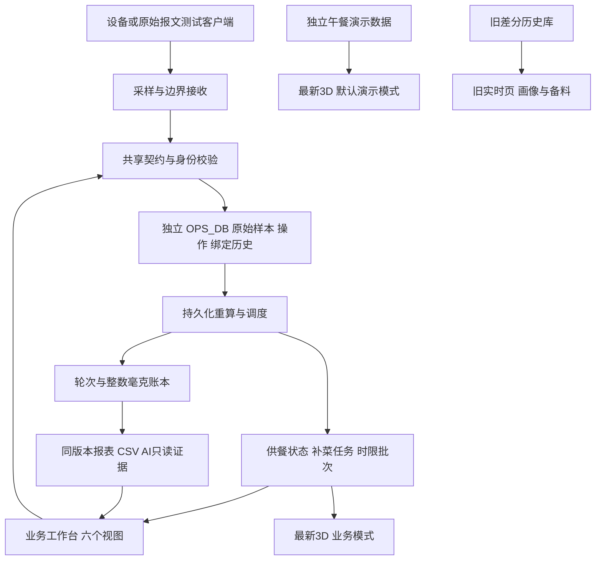

# 业务系统运行与恢复

本文对应 `operations-v2`，与旧称重系统及 3D 午餐演示分别存储。业务代码使用真实 D1；测试设备发送的原始读数仍属于测试数据，不表示已完成实机验收。

## 本地独立验收

先在主体项目目录运行前端（仅启动前端，不启动旧备料调度）：

```sh
node scripts/run-framework.mjs dev
```

再打开另一个终端，在同目录执行：

```sh
npm run dev:operations
```

默认地址为 `http://127.0.0.1:5183/operations`。该进程使用 `.wrangler/operations-test/d1`，环境固定为 `test`，只读代理既有 `5173` 前端；非 v2 路径禁止写入。它不会改写 `.env`，也不使用旧经营库或午餐演示的数据库。

初始管理工作站凭证保存在 `.wrangler/operations-test/connection.json`，文件权限为 `0600`，目录已被 Git 忽略。页面登录后使用环境专属 HttpOnly、SameSite=Strict cookie；凭证不写 localStorage。重启复用同一文件和数据库。不要把该文件贴到日志或交付文档中。

可使用 `OPS_TEST_PORT`、`OPS_TEST_DIRECTORY`、`OPS_TEST_FRONTEND` 指定独立实例。`OPS_TEST_TOKEN` 仅用于显式配置初始测试凭证，不会覆盖数据库中已经存在的凭证。设备凭证由管理页创建并限定 scaleId；员工凭证不能上传设备报文或修改管理配置。

最新 Three.js 项目位于主项目旁的 `apps/restaurant-3d`。显式 `?mode=live` 使用业务供餐接口；其开发代理 `OPERATIONS_API_TARGET` 应指向同一业务服务。默认演示继续使用 `/api/demo/v1`。业务 3D 按后端真实返回的绑定排列，不借用演示菜品、人数或行走轨迹。

## 主体或独立 Worker 部署

主体 `/api/v2/*` 已装配真实业务服务，但必须提供独立 `OPS_DB` 绑定与明确的 `OPS_V2_ENVIRONMENT=test|demo|live`。缺少配置返回 503，不回退旧库或演示数据。

主体 Vite 配置支持同时设置 `OPS_V2_ENVIRONMENT` 和 `OPS_V2_DATABASE_ID`，增加独立 D1 绑定与每分钟调度。只设置其中一个会直接报错。初始工作站令牌使用服务器秘密配置 `OPS_V2_BOOTSTRAP_TOKEN`，不得加入公开构建参数或前端变量；它只在初始凭证不存在时创建记录。后续新增与撤销凭证走管理接口。

另提供 `wrangler.operations.example.jsonc` 和 `build/operations-worker.ts`，可把业务 API 独立部署。示例数据库 ID 是占位值，部署前需填写独立数据库并配置秘密。独立部署时前端与 3D 应通过同源 `/api/v2` 转发，保留原始请求 origin，不开放跨站 cookie 写入。实际部署地址、凭证和现场参数由部署环境提供；本次本地验收没有向远程环境发布。

## 初始化顺序与口径

1. 在管理页登记设备、点位排列、初始菜品与容器绑定，配置皮重、满盘标准、读数新鲜度、稳定窗口和边界匹配窗口。测试参数不作为门店默认值。
2. 按菜配置供餐规则与时限规则。未配置时显示未知或未配置，不生成虚构阈值。
3. 发放限定设备的网关凭证、员工与管理工作站凭证。
4. 使用 [硬件对接清单](HARDWARE-HANDOFF.md) 和 JSONL 客户端发送原始报文，逐项检查回执。
5. 在工作台启动时限批次。批次保存开始时的规则快照；补菜不会重置计时。撤下、报损或换盘只提交一次 v2 事务。

设备已绑定期间不直接覆写计量基线或菜品身份。通过撤盘关闭旧绑定，更新配置后建立新绑定；换盘事务保留历史区间。边界按发生时间归属绑定，区间禁止重叠。

连续读数提供实时估计与最后确认值，轮次账本提供唯一确认取用量。加冰等导致食物组成未知时，净载荷不冒充食物余量。操作填写“已测量”不等于完成核验；须有同绑定、同启动、近时前后读数，变化量相符且没有冲突操作。界面可以读取并选择这些依据。

报表归属日取回后厨事件的上海日期，范围含开始日和结束日，最多 31 天。未知值为 null，可信零为 0；同菜缺菜时长取多盘共同空盘的交集。证据不足时不补齐未知区间。报表与 CSV 使用同一版本，重算期间拒绝导出旧结果。

旧每日画像、档案、备料入口继续保留 `legacy_delta_v1` 来源说明。新旧口径不隐式相加；档案保留原值，通过同一截止时点指纹标注 current/outdated/unknown，确认的备料计划不被重新计算覆盖。

## 后台作业与故障处理

采样、操作、绑定变更与重算任务在同一 D1 事务持久化。每个绑定只有一个重算任务，任务带租约和目标版本；旧工作者无法覆盖新任务。允许的近未来报文保留待运行时间，到时再计算。迟到证据使旧供餐区间失效，避免继续宣称已知空盘。

Worker 的每分钟定时器处理重算、任务暂缓到期和供餐复核；本地独立实例每 5 秒运行。浏览器关闭后业务作业继续。页面提示音仍需浏览器开启、员工主动启用，不承诺关闭页面后的推送通知。

失败任务保留为 failed，采用有上限的退避；报表显示失败状态，原始数据不被删除。修复服务后继续调度即可重试。未过期租约不会挤占其他可运行任务的执行名额。

迁移是增量建表、索引和约束，不清空旧库。代码只在显式配置的独立业务库初始化。管理页可配置原始样本保留期（24–8760 小时）；默认 24 小时且关闭自动清理，需管理者明确启用。启用后仅删除采样时间和接收时间均已超期、且没有业务引用保护的原始样本。

活动绑定、待核实轮次、未核实操作、活动任务与未完成作业涉及的样本保守保留；永久保留操作、边界、轮次修订、账本与算法依据。清理后的样本留下身份与内容哈希，重复上报仍能识别，同身份异内容仍冲突。保留期不是“所有波形到期必删”的承诺。清理测试实例时先停止对应进程，核对专用测试目录，不对旧经营目录执行清理命令。

“设置与诊断”显示调度开始及完成时间、失败码、各状态重算作业数、待核实轮次、未关闭任务及保留策略执行记录。心跳独立持久化，不因每次空闲调度改变报表版本。页面关闭不影响这些记录；没有调度记录时显示未知。

## 备份和恢复

`lib/operations-v2/backup.ts` 提供环境限定、带 SHA256 的逻辑快照，包含原始数据、账本版本、任务、凭证散列与回执。并发写入导致版本变化时重新读取；半完成恢复不能再次导出成完整备份。快照没有明文令牌，仍应按经营资料保管。

本地维护脚本要求停止目标实例、显式给出目录、环境与数据库标识。以下示例只适用于默认独立测试实例：

```sh
node --experimental-strip-types scripts/operations-backup.mjs backup \
  .wrangler/operations-test/d1 /absolute/private/test-backup.json test operations-isolated-test
node --experimental-strip-types scripts/operations-backup.mjs restore \
  .wrangler/operations-restored/d1 /absolute/private/test-backup.json test operations-isolated-test
```

备份不会覆盖已有文件。恢复必须使用同一环境的新空数据库，校验清单和摘要，并逐表对账；不得把 live 凭证恢复到 test。恢复中断时留下持久锁，API、普通业务写入和后台作业拒绝使用半恢复结果。丢弃失败的专用恢复目录，在新的空目录重新恢复。完成后保留原库作为回退，只在核对成功后切换实例目录。

目标数据库使用新的 generation，旧报表、导出版本和分页游标必须重新读取；不能只比较版本末尾的数字。调度心跳属于实例诊断，不复制成新实例已经运行的证明。保留策略和样本身份哈希随业务备份保存。

逻辑脚本使用本地 Miniflare D1 标识，远程 D1 的原生备份应由部署平台另外保存；不能把本地命令当成远程数据库备份。原工作站明文凭证应由其持有方另行保管。

## 验证入口

```sh
npm run typecheck
npm run lint
npm test
npm run build
```

`tests/operations-http.test.ts` 经实际 HTTP 发送原始样本与边界；`operations-consistency` 与 `operations-integration-boundaries` 检查独立 D1 边界；`operations-recovery` 重启 workerd 并进行备份恢复；`operations-services` 核对任务、报表及旧业务兼容。浏览器脚本中 `operations-http-ui-smoke`、`operations-evidence-http-ui-smoke`、`operations-history-http-ui-smoke` 和 `operations-system-http-ui-smoke` 使用真实隔离服务；`operations-ui-smoke` 使用 schema fixture，分别记录。

真实硬件的安装、时钟精度、网关断网缓存、设备数量与现场阈值仍需现场联调。本地软件回放与浏览器验证不能替代实机验收。

## 项目主体和数据流



前后端共享入口为 `lib/contracts/operations-v2.ts`。业务装配为 `lib/operations-v2/application.ts`，持久化为 `storage.ts`，主体路由为 `app/api/v2/[...path]/route.ts`。最新 3D 是相邻的 `apps/restaurant-3d`，不是旧的 `red-koala-3d-ui`。

| 页面或功能 | 实际接口（共同前缀 `/api/v2`） | 数据来源及处理 | 当前边界 |
| --- | --- | --- | --- |
| 登录与角色 | `/session` | 环境专属凭证散列、HttpOnly 会话 | 工作站身份；没有虚构个人账号体系 |
| 实时、后厨、前厅 | `/serving/state`、`/refill/tasks`、任务详情与 actions | 原始样本 → 计量投影 → 状态、建议及持久任务 | 事实、建议、质量、位置四者独立 |
| 操作与更正 | `/operations` GET/POST、`/operations/boundary` | 不可变原操作、更正链、人工来源与审计 | 未形成轮次也能按绑定和日期找回 |
| 轮次核实 | `/cycles`、单轮次详情与 review | 边界、样本、操作、计算摘要与历史版本 | 缺失依据不能靠手工“确认”制造重量 |
| 前后称重依据 | `/bindings/{id}/evidence` | 原始样本身份、重量、质量与时刻 | 输入测量量仍需后端核验；未知不等于零 |
| 取用报表与 CSV | `/reports/consumption` 及 export | 当前有效轮次账本、有效绑定、供餐区间 | 上海日期、同版本；旧口径由旧入口查看 |
| AI 读取新账本 | `/intelligence/evidence` | 与报表一致的数据版本及完整行 | 只读、不自动调用模型、不混入旧模型训练 |
| 时限与报损 | `/freshness/rules`、batches、removals 与操作接口 | 批次规则快照、撤下动作和绑定事务 | 部分撤下不重置计时，整盘撤下只关闭一次 |
| 设置与接入 | `/devices`、diagnostics、`/serving/rules`、`/access/credentials` | 设备配置、绑定、质量规则和接收诊断 | 设备范围、员工与管理权限分别校验 |
| 运行与保留 | `/system/diagnostics`、`/system/retention` | 调度心跳、持久作业、版本化保留策略 | 删除范围受引用保护；默认未启用清理 |
| 最新 3D `?mode=live` | `/session`、`/serving/state` | 同一业务绑定与供餐 DTO | 固定排列不等于实物位置；无人物和经营假数据补齐 |
| 最新 3D 默认模式 | `/api/demo/v1/*` | 独立演示场景和回放 | 菜品、顾客、轨迹与营业过程属于模拟 |
| 旧画像与备料 | 原 `/api/intelligence/*`、`/api/preferences/*` | `legacy_delta_v1` 历史与既有模型 | 原有确认计划保留，新旧统计不相加 |

## 本次软件范围验收对应

以下记录对应 2026-10-12 的本地实现，契约 `operations-v2 / 2.0.0-dev.4`，32 个业务端点及独立 session。测试库使用模拟原始报文，页面调用真实业务服务；表中的“实现”不表示已经在门店或远程生产部署。

| 范围 | 实现位置和行为 | 验证依据 |
| --- | --- | --- |
| D01 契约 | `lib/contracts/v2`；输入输出校验、未知/null、逐项回执、错误码 | 全注册表 fixture 双向校验；HTTP 拒绝非法字段与内容冲突 |
| D02 身份及隔离 | security、session、router；设备范围、员工/管理、test/demo/live | 未认证/越权、跨源写、跨环境凭证、同库隔离 |
| D03 原始接收 | telemetry、storage；原始身份、接收时刻、去重、迟到与重启流 | 真 HTTP 写 D1、1000 样本批量、未来时刻调度、旧故障不覆盖恢复 |
| D04 正式计量 | measurement、projection；绑定历史、整数毫克轮次账本 | T01/T02 原始 HTTP 精确对账；旧 orphan 失效且不重复入账 |
| D05 操作及核实 | operations、evidence；六类操作、手工边界、更正链 | 原始依据勾选、更正并重算；无轮次操作刷新后可追溯 |
| D06 供餐 | serving；状态、建议、质量、位置分离与阈值回滞 | 连续下降、半盘、可信零、离线、跨 boot 故障、过期位置 |
| D07 任务 | tasks；任务唯一、并发接手、暂缓、交接、核验与关闭 | 双浏览器一成功一409；同请求幂等；关闭页面后到期调度 |
| D08 页面 | `/operations` 六视图；hooks、client、表单和诊断 | 真实 HTTP 操作链与严格 fixture；390px 移动端、错误保留旧值 |
| D09 报表 | reports；日期、菜品多盘、排名、覆盖、共同空盘与应供日数 | 上海跨日跨月；unknown/zero；CSV/AI/分页固定版本及时间 |
| D10 更正和画像 | 重算作业、不可变修订、snapshot-version、archive-repository | 旧画像过期提示；显式新版本、并发相同指纹去重、旧确认计划保留 |
| D11 旧业务兼容 | compatibility 与旧 analysis/preferences 入口 | 部分撤下保留计时，整盘关闭一次；旧模型数据不混入新账本 |
| D12 运行恢复 | application、system、retention、backup、Worker scheduled | 真实 workerd 重启；半恢复锁/并发；新库 generation；清理引用保护和续跑 |
| D13 分层验收 | 纯规则、真实 SQLite/D1、HTTP、浏览器、构建产物 | 原始输入不携带取用真值；测试结果按层记录，见下表 |
| D14 硬件交接 | 原始 JSONL 客户端、只读探针及 HARDWARE-HANDOFF | 客户端稳定 ID 重试、逐项回执；实际软件 HTTP 联调，实机未验收 |

| 原计划场景 | 已覆盖的软件检查及层级 |
| --- | --- |
| T01 | 原始 HTTP 800g→600g 确认200g，重传后只有一个有效账本版本 |
| T02 | 原始 HTTP 800g + 冰100g − 回盘600g − 排水50g = 确认250g；未知量保持待核实 |
| T03 | 纯计量测试后厨撤下100g不计顾客取用，随后轮次基线正确 |
| T04 | 连续下降显示估计及各自时刻，不以旧确认值替代当前值 |
| T05 | 真实轮次半盘暂缓；最新待核实轮次不能被跳过借用更早已确认轮次 |
| T06 | 服务测试少量变空升级同一任务，暂缓不能遮蔽紧急情况 |
| T07 | D1 与双浏览器争抢，一成功一冲突；原请求重试只有一次业务影响 |
| T08 | 服务和浏览器报告完成进入核验；加冰不证明完成补菜；人工核实有权限与依据 |
| T09 | 缺测、故障、跨 boot、拿盘、换盘、组成未知不补算取用；时限绑定保持一致 |
| T10 | 原始 HTTP 先入口后出口与引用样本迟到重建；不双计、不倒退当前状态 |
| T11 | D1 多盘覆盖与空盘交集，一盘有菜或未知不宣称整菜可信断供 |
| T12 | 上海结束日归属、跨月历史菜名、范围和 CSV 对账；查询时间也固定 |
| T13 | 实测更正链和旧版保留；迟到证据使旧区间失效；画像指纹和显式重新生成 |
| T14 | 无数据、可信零、部分覆盖、历史停用分别表达；无依据不制造排名 |
| T15 | workerd 关闭重启、租约过期恢复；定时处理不依赖浏览器；恢复不重复记账 |
| T16 | 同库跨环境及独立实例、权限、缺少绑定503；生产构建不静默回落演示 |

### 验证记录的适用边界

- 全量主体测试包含旧模型、演示与新业务，并非全部是原始 HTTP 测试。原始 HTTP、D1 服务、纯计量与浏览器分别由 `operations-http`、`operations-services`/`integration-boundaries`、`operations-measurement`、`*-http-ui-smoke` 提供证据。
- 画像版本生成使用真实临时 SQLite 仓储测试；页面交互使用严格 API fixture。没有对旧经营库执行重新生成，也未调用真实外部模型。
- H09 软件批量测试为42个独立配置设备、1000条原始样本及持久投影，不是42台物理秤持续整班上报。耗时受同机并行测试影响，不据此宣称达到 P95 < 1 秒或现场提醒 SLA。
- 实机采样、时钟、断网缓存、安装、边界能力、现场人数/位置、营业日历、经营阈值及生产部署仍需实际接入。3D 中动态顾客和员工只属于演示模式；业务模式使用固定绑定排列。
- 原有工作区已有大量未提交和未跟踪变更，本次没有执行 reset、clean、旧库覆盖、提交或发布。运行服务位于本机，关闭进程后按本文命令启动。

### 最终验证结果（2026-10-12）

| 检查 | 结果 |
| --- | --- |
| 主体 `npm test` | 273/273 通过，0失败、0跳过；[原始日志](../../../output/operations-v2-2026-10-12/final-main-tests.log) |
| 主体 `npm run typecheck`、`npm run lint` | 均通过 |
| 主体 `npm run build` | 通过；实际构建产物登录页200，未配置业务库时接口503 |
| 最新3D `npm test`、`npm run build` | 56/56通过，构建通过；[测试日志](../../../output/operations-v2-2026-10-12/final-three-tests.log) |
| 独立业务 Worker 打包 dry-run | 通过；未远程部署 |
| 四个实际 HTTP 浏览器脚本 | 任务、称重依据更正、无轮次操作历史、运行诊断与 AI 证据全部通过 |
| 严格 fixture 浏览器脚本 | 全32端点schema、异常交互、权限、移动视口、画像旧版本保留通过 |
| H09 原始批量输入与持久投影 | 42个配置设备、1000个样本，最终本机执行5639ms；不代表现场持续吞吐或P95 |

浏览器逐项说明见 [前端验证记录](FRONTEND-VALIDATION-2026-10-12.md)，操作说明见 [工作台使用说明](WORKBENCH.md)。截图及测试日志保存在工作区 `output/operations-v2-2026-10-12/`；测试凭证只保存在忽略提交的本地连接文件中。


## 后厨轨道与自动补菜上线准备（2026-10-13，本轮未发布）

1. 在独立测试环境配置轨道长度、方向、盘托位置、后厨入口/出口和窗口，设置实际心跳有效期。生产默认没有轨道，不启用自动补菜。
2. 分别授权称重设备 `scaleIds` 和轨道网关 `trackIds`。持续上报带 bootId/sequence 的运动心跳；停止时仍有心跳、速度为零。移位故障上报 positionValid=false。
3. 现场静止对齐基准，读取最新心跳后提交校准；不以演示尺寸、速度或采样周期替代现场参数。
4. 校验真实进入/离开后厨事件及 sampleRef，与设备绑定、稳定称重窗口相符后启用自动识别。位置推算不代替这些证据。
5. 员工使用 `/operations/kitchen?windowId=窗口编号`。常规补菜无需点击；加冰/排水支持多选并返回逐盘回执；撤菜/换盘在详情确认。任务详情与旧人工接口仍可使用。
6. 检查“系统推断”的处理段和任务自动完成依据；晚到例外可能重新打开待核实任务。关闭自动识别不会停止已存在记录的更正重算。
7. 逻辑备份包含处理段、历史修订和轨道原始遥测。恢复到新的同环境数据库后重新校准位置；保留历史依据，勿批量覆盖旧账。

真实机械移位只有在设备或人员报告后才能获知；没有检测信号时必须停机检查并重新校准。现场验收仍需覆盖传感器漂移、取碗操作、网络断连与实际采样周期。
